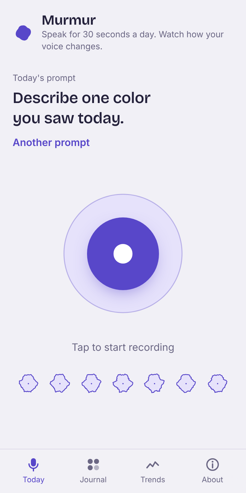
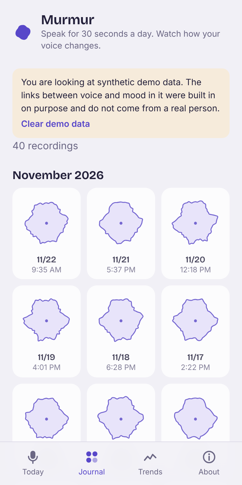

# Murmur · 低語日記

A private voice journal that runs entirely in your browser. Speak for about 30 seconds a day, and Murmur measures your pitch, pitch movement, speaking rate, pauses, and voice regularity on your own device. Over time it shows how your voice changes compared with your own usual range, and, if you check in with a quick mood and energy rating, how your voice relates to how you feel.

**Try it:** https://jen900704.github.io/murmur-voice-journal/
(On a phone, add it to your home screen and it works like an app, including offline.)

[中文說明在下方](#中文說明)

<p>
  
  
  
</p>

The screenshots use the app's built-in synthetic demo data.

## Why

Speech features like pitch variability, speaking rate, and pausing appear throughout research on mood and mental health, but voices differ a lot between people. A number that is low for one person is ordinary for another. Murmur therefore never compares you with population norms. It compares you with yourself, and it lets you see whether your own voice tracks your own self-reports.

It is meant for self-reflection and for people curious about speech measurement. It is not a diagnostic tool.

## Privacy

- Audio is decoded and analyzed in the browser, in a Web Worker. Nothing is uploaded.
- Entries, recordings, and settings are stored in IndexedDB on your device. There are no accounts, analytics, trackers, or third-party requests. The only network requests are for the app's own files.
- You can keep only the measurements and not the audio (a setting), export everything as CSV or JSON, and delete everything at any time.

## What it measures

Each recording is resampled to 16 kHz mono, high-pass filtered at about 50 Hz to remove DC offset and rumble, and analyzed in 25 ms frames with a 10 ms hop.

| Feature | How it is computed |
|---|---|
| Pitch (Hz) | Median F0 over voiced frames. F0 from YIN (de Cheveigné & Kawahara, 2002): 0.15 threshold, 70 to 500 Hz range, parabolic interpolation on the difference function, and frames whose best period lies outside the range treated as unvoiced. Then 5-frame median smoothing, and removal of frames more than 1.8 times away from the median of their own 300 ms neighbourhood (octave errors). |
| Pitch movement (semitones) | Standard deviation of F0 in semitones. |
| Pitch range (semitones) | Distance between the 5th and 95th percentile of F0, in semitones. |
| Speaking rate (syllables/s) | Syllable nuclei divided by the time from first to last speech frame. Nuclei are intensity peaks at or near voiced frames that rise at least 2 dB above the preceding dip and are at least 80 ms apart, following de Jong & Wempe (2009). |
| Articulation rate (syllables/s) | Syllable nuclei divided by speaking time, excluding pauses. |
| Pause time (%) | Silent time between the first and last speech frame, as a share of that span. Silences shorter than 250 ms are not counted as pauses. |
| Average pause (s) | Mean duration of those pauses. |
| Loudness movement (dB) | Standard deviation of frame intensity over speech frames. Absolute loudness is not reported because it depends on the microphone and distance. |
| Voice regularity (dB) | 10·log10((1 − a) / a), where a is the lowest YIN aperiodicity within the pitch range, computed on every speech frame (voiced or not) and summarized by the median. Breathiness lowers it, but so do background noise and lossy recording, so it is only comparable across recordings made in similar conditions. It is related to, but not the same as, Praat's harmonics-to-noise ratio. |

Speech activity is found with an adaptive energy threshold placed between the recording's noise floor (5th percentile of frame energy) and its peak (99th percentile). A recording is rejected as "no speech" when fewer than 0.5 s of frames, or fewer than 20% of speech frames, are voiced, so noise or breathing alone is not saved.

**Recording conditions.** The app asks the browser to switch off echo cancellation, noise suppression, and automatic gain control, because they change pitch and loudness dynamics, and records at 128 kbit/s. Browsers do not always comply, so each entry stores the settings the browser actually applied, the container format, the share of clipped samples, and an SNR estimate (median speech energy minus the noise floor). Recordings with more than 1% clipped samples or an SNR below 15 dB are flagged, kept in the journal, and left out of baselines, trends, and correlations. Features are computed from the browser's compressed recording (Opus or AAC), not from raw PCM.

**Personal baseline.** Once you have 10 usable recordings, a value is compared with the median of your *earlier* recordings, scaled by the median absolute deviation (MAD × 1.4826). A value more than 2 scaled MADs away is shown as clearly higher or lower than usual. When nothing has changed, this flags roughly 5% of values per feature, which a unit test checks.

**Voice and self-report.** Once 20 recordings have mood and energy ratings (1 to 7), Murmur shows Spearman correlations between each feature and each rating, with approximate 95% intervals from the Fisher z transform using the Bonett and Wright (2000) variance for Spearman's rho. A correlation is not shown when the feature has fewer than 5 distinct values or the ratings fewer than 3. The app says plainly that these are 18 correlations at once and that daily entries are not independent (shared drift, such as a week-long cold, inflates them), so the true uncertainty is larger than the intervals. Cells whose interval includes zero are greyed out.

**What gets pooled.** Synthetic demo entries are never mixed with your own: once you have one real entry, only real entries are used. Entries computed with an older version of the feature code are not pooled with newer ones.

## Validation

`tools/validate.sh` synthesizes English and Mandarin speech with eSpeak NG and compares Murmur with Praat (via Parselmouth) and with the known syllable count.

| File | F0 Murmur | F0 Praat | Syllables found | True syllables |
|---|---|---|---|---|
| English, 130 wpm | 92.9 | 92.0 | 30 | 34 |
| English, 160 wpm, higher pitch | 123.6 | 123.2 | 35 | 34 |
| English, 200 wpm | 92.3 | 91.8 | 19 | 34 |
| Mandarin (pinyin), slow | 90.7 | 89.5 | 35 | 32 |
| Mandarin (pinyin), fast | 90.7 | 89.5 | 29 | 32 |

Median F0 agrees with Praat within about 1 Hz. The syllable count is within about 12% at ordinary rates but undercounts very fast speech, where intensity dips between syllables become too shallow. Synthetic speech is a limited test. Validation on recorded human speech, across phones and rooms, is the obvious next step.

The unit tests (`npm test`) cover YIN on harmonic tones from 90 to 380 Hz, rejection of a 600 Hz tone instead of reporting it at a subharmonic, pause and syllable detection on speech-like signals with known structure, robustness to noise and to a DC offset, rejection of noise-only audio, survival of real pitch excursions wider than an octave, voice regularity falling with added noise and with breathiness, clipping and noise flags, the direction of each feature under controlled changes, the false-flag rate of the baseline rule, and the statistics helpers against SciPy.

## Limitations

- Phone microphones, distance, background noise, and colds all change these numbers. Recording in a similar place and position each time helps.
- Browsers differ in how much audio processing they let an app turn off. Some iPhone models may still apply processing.
- Speaking rate is an estimate based on intensity peaks, not a transcript.
- The correlations are descriptive and based on one person's data. They are leads to be curious about, not findings.
- Music, singing, or a TV in the background can pass the voicing check and produce numbers that are not about your speech.
- Safari on iPhone may clear site data after 7 days without a visit unless Murmur is used from the home screen, and the home-screen app keeps its data separately from Safari tabs. Exported backups contain measurements only, not audio.

## Run it locally

No build step and no dependencies.

```bash
git clone https://github.com/jen900704/murmur-voice-journal
cd murmur-voice-journal
python3 -m http.server 8080   # then open http://localhost:8080
npm test                      # unit tests (Node 18 or later)
```

Microphone access requires `https` or `localhost`. The test suite needs no browser; `tools/validate.sh` additionally needs eSpeak NG, FFmpeg, and Python with `praat-parselmouth`.

```
index.html            app shell
js/features.js        feature extraction (pure functions, also runs in Node)
js/stats.js           baseline and correlation helpers
js/worker.js          runs the analysis off the main thread
js/recorder.js        microphone capture, decoding, resampling to 16 kHz
js/db.js              IndexedDB storage
js/viz.js             voice shapes and charts (SVG)
js/i18n.js            Traditional Chinese and English text
sw.js                 offline cache
tools/validate.sh     comparison with Praat on synthesized speech
tools/make-demo.mjs   builds the synthetic demo data
```

The voice shape for each entry is the recording's pitch contour wrapped around a circle: the outline moves outward when pitch rises above that recording's median and inward when it falls, and loudness thickens it slightly.

## Demo data

The app can load 40 days of synthetic entries so you can see the trends and correlation views without recording for weeks. Those entries were made by running the real analysis on generated speech-like audio, and the relation between voice and mood in them was built in on purpose. The app labels them clearly and can remove them in one tap.

## If things are hard

Murmur is not a substitute for care. In the US, call or text 988. In Taiwan, call 1925 (安心專線, 24 hours).

## References

- de Cheveigné, A., & Kawahara, H. (2002). YIN, a fundamental frequency estimator for speech and music. *The Journal of the Acoustical Society of America, 111*(4), 1917–1930.
- de Jong, N. H., & Wempe, T. (2009). Praat script to detect syllable nuclei and measure speech rate automatically. *Behavior Research Methods, 41*(2), 385–390.
- Bonett, D. G., & Wright, T. A. (2000). Sample size requirements for estimating Pearson, Kendall and Spearman correlations. *Psychometrika, 65*(1), 23–28.

## License

MIT. The Bricolage Grotesque font is licensed under the SIL Open Font License (`fonts/OFL-bricolage.txt`).

Made by [Hsiang-Chen (Jen) Yeh](https://jen900704.github.io/jen-portfolio/).

---

## 中文說明

Murmur 低語日記是一個完全在瀏覽器裡執行的聲音日記。每天說大約 30 秒的話，它會在你的裝置上算出音高、音高起伏、語速、停頓和聲音規律度。累積幾次之後，它會告訴你今天的聲音和你自己的平常範圍相比是高、低，還是差不多。如果你每次花兩秒標記心情和精神，它也會顯示你的聲音和你的感受之間的關聯。

**直接使用：** https://jen900704.github.io/murmur-voice-journal/
在手機上用 Safari 按「分享」→「加入主畫面」，就可以像 App 一樣使用，離線也能用。

**為什麼只跟自己比。** 音高起伏、語速、停頓這些特徵常出現在情緒和心理健康的語音研究裡，但每個人的聲音差異很大。對一個人來說偏低的數字，對另一個人可能很正常。所以 Murmur 不拿你和其他人比較，只拿你和你自己比較。

**隱私。** 錄音在瀏覽器裡解碼和分析，不會上傳。所有資料存在你裝置上的 IndexedDB，沒有帳號、沒有追蹤、沒有第三方請求。你可以選擇只保留數據不保留錄音，也可以隨時匯出或全部刪除。

**和自己比的規則。** 累積 10 筆可用的紀錄後，每筆新的數值會和你之前的紀錄比較（中位數加減 2 個標準化的 MAD）。在什麼都沒變的情況下，大約只有 5% 的數值會被標成「明顯比平常高或低」。爆音或背景噪音太大的錄音會保留，但不會拿來算平常範圍。聲音和心情的相關要等到有 20 筆標記後才顯示，並且會清楚說明同時看了很多個相關、每天的紀錄彼此不獨立，所以只能當作線索。

**它不是什麼。** Murmur 不是醫療器材，不做診斷。手機麥克風、距離、環境噪音、感冒都會影響數字，每次在差不多的地方、用差不多的姿勢錄，結果會比較穩定。

**驗證。** 用合成語音和 Praat 比較，音高中位數相差約 1 Hz。正常語速下音節數誤差約 12% 以內，但非常快的語速會低估。這只是合成語音上的檢查，還需要用真人錄音驗證。詳細方法和數字見上方英文說明的 Validation 一節。

**資料可能會不見的情況。** iPhone 的 Safari 如果超過 7 天沒打開這個網站，可能會清掉資料，加入主畫面後使用可以避免；主畫面 App 和 Safari 分頁的資料是分開的；匯出的備份只有數據，沒有錄音檔。

如果你最近過得很辛苦：台灣可撥安心專線 1925（24 小時），美國可撥打或傳訊 988。
