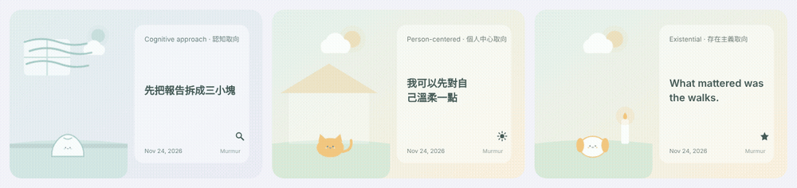

# Murmur · 低語日記

**Look at one worry from 14 counseling perspectives, in your own words, on your own phone.**

Write down what is on your mind. Pick an angle (psychoanalytic, Adlerian, existential, person-centered, Gestalt, behavioral, acceptance, REBT, cognitive, reality, feminist, solution-focused, narrative or family systems), answer three short questions in that approach's style, and get back your own words, the approach's perspective, one small thing to try, and a card whose picture is drawn from what you wrote. Nothing leaves the device.

**Try it:** https://jen900704.github.io/murmur-voice-journal/ (add it to your home screen and it works offline)

[Try it](https://jen900704.github.io/murmur-voice-journal/) · [Design notes](docs/change-the-angle.md) · [Architecture](docs/architecture.md) · [Research modules](#research-and-engineering-modules) · [Privacy](PRIVACY.md) · [中文說明](#中文說明)

> **Not therapy, not for emergencies.** Murmur is psychoeducation for self-reflection. If you are not safe right now, contact local emergency services or find a help line at [findahelpline.com](https://findahelpline.com). Help lines for Taiwan and the US are one tap away on every screen.

<p></p>

[](https://github.com/jen900704/murmur-voice-journal/actions/workflows/test.yml)  

## Why

Most self-help apps offer one way of looking at a problem. Counselors learn many, because what helps depends on the person and the situation. Murmur lets anyone try several of those ways on the same worry and notice which one opens something up, while being clear that this is psychoeducation for self-reflection, not therapy.

- **Your words, not templates.** The summary quotes what you wrote, question by question. It never builds sentences around your answers.
- **Follows you when a model is available.** With the browser's on-device model, or your own API key if you turn that on, the questions are reworded for your worry, one follow-up picks up a phrase you wrote, and the closing is written for your situation. Every model output is checked (quotes must be your own words, no praise, no diagnosis, risk screen) and anything that fails falls back to the reviewed text. Without a model, the reviewed text is used.
- **Explainable.** When an angle is suggested, you see the exact words that suggested it. Every part of the card picture can tell you which word it came from.
- **Private by design.** No account, server, analytics or remote fonts. Voice is analyzed in the browser; everything is stored in IndexedDB and can be exported or deleted.
- **Safe by default.** Every free-text field goes through a Chinese and English risk screen that pauses with help lines for the person's region. Cards are never drawn from text that trips it.
- **Tested.** Unit tests, about 240 Playwright end-to-end tests in Chromium and WebKit, accessibility checks on every screen, and research modules with preregistered evaluations.

## What stays on the device

| | Works offline | Leaves the device |
|---|---|---|
| 換角度, cards, ratings | yes | never |
| Voice journal | yes | never (audio is analyzed in the browser) |
| Language mirror, imports | yes | never |
| Bedtime ritual and tracks | yes (device voices only) | never |
| Sharing a card | yes | only the image you choose to share |
| AI conversation (off by default) | no | that conversation, to the provider you chose, with your own key |
| Research modules in `lab/`, `infra/` | n/a | they never receive anyone's journal; they run on scripted or synthetic data |

## How 換角度 works

1. Write the worry and pick one or more kinds (work or school, relationships, family, self, loss, other). Optionally rate how heavy it feels, 0 to 10.
2. Choose an angle: suggested from your words with the matched phrase shown, from a list ordered for that kind of worry, at random, or three side by side. Loss only offers the five approaches suited to grief.
3. Answer three questions. "Not sure" is fine and is never quoted back.
4. Read the summary, rate how heavy it feels now, and keep the card. Look at the same worry from another angle and see what the new one brought up.

The design, the research each part borrows from, and the limits are in [docs/change-the-angle.md](docs/change-the-angle.md). How the app words what it is, and the Taiwan and US rules behind that, are in [docs/wording-and-law.md](docs/wording-and-law.md). What happens to data after weeks of use, and how research donation could work, is in [docs/data-lifecycle.md](docs/data-lifecycle.md).

## Also in Murmur

Smaller features around the core. They share the same privacy and safety rules.


- **Voice journal.** Speak for about 30 seconds (at least 5, at most 90); see pitch, pace, pauses, and voice regularity against your own usual range. Until there are 10 usable recordings to form that range, the result screen shows the voice shape and the check-in first, with the numbers folded under "See the numbers". The journal also has a short look back at the last seven days.
- **Silent check-in.** When speaking aloud is not possible, note mood, energy and one line without recording. These entries are listed in the journal and counted in the seven-day look back, but stay out of the voice trends, the usual range, the correlations, and the CSV export. A low mood rating in one still brings up the low-mood note.
- **Language mirror (語言鏡).** Opens from Today, from the Journal, or from the summary of a 換角度 exercise. Type a sentence and the counted words light up as you type (seven kinds of words, each with its own mark); the results add a word fingerprint you can save as a picture. Paste your own writing or import your own social media data export (Instagram, Facebook, X, Threads, Reddit), and see transparent, on-device language analysis: pronouns, thinking style, feelings, relationships, power and politeness, loss, motives, moral themes and writing style, each with the exact words that counted, an interval, what it cannot tell you, and a downloadable evidence report. It is for self-reflection, not assessment; it shows no personality scores and cannot judge mental state or honesty. Chinese categories are written for Murmur (LIWC and C-LIWC cannot be bundled).
- **Too much right now.** One button for breathing (4-2-6, optional on-device voice), then 5-4-3-2-1 grounding, then self-compassion phrases to tap and hear.
- **Write it out.** Prompts by weight; the deep ones follow Pennebaker's expressive writing (15 minutes, can repeat over days), with a short closing afterwards.
- **Bedtime ritual.** Set a worry down, note one kind thing you did for yourself, and listen to one of nine wind-down tracks of about three to five minutes, each in the style of a counseling approach suited to bedtime, read by your phone's own voice (or shown as slow read-along text). From 8 pm to 4 am the ritual's card comes first on Today; at other times it is a link there. You get a pastel postcard to keep or share. Every step can be skipped, "Just listen" goes straight to a track, and there are no streaks. The whole ritual is shown in dark colors, whatever the system theme.
- **Goodnight card.** Send one pastel card to one person through your phone's share sheet. It carries only a line you pick, never what you wrote; there is no feed, count, or read receipt.
- **Breathe for a minute.** A one-minute pacer (in for 4 seconds, out for 6) on Today and on the low-mood note.
- **Kindness jar.** The kind things you noted, kept privately. When the latest mood check-in is low (1 or 2 out of 7, within the last 36 hours), up to three of them come back, along with three small general actions many people find a little helpful (not other users' posts, so there is nothing to compare against). In the evening the note is shorter: one kind thing, one small action, breathing, and help.
- **Daily prompt.** Everyone gets the same prompt (one of 40) on the same day, and you can swap answers with someone through a link.
- **AI conversation (experimental, off by default).** After a theory-lens exercise, continue as a conversation with an AI model that stays inside that approach: instructed to give one reflection and one question per turn, avoid praise and reassurance, and use only techniques suitable for self-help. Risk words in your message pause it with help lines (you can still send); a risky reply without help lines is held back; the chat ends when the model gives help lines, or when a reply comes back empty or refused. At most ten turns, the last one a short summary. Uses your own API key.
- **Bedtime reminder.** Add a daily calendar event at a time you choose; Murmur sends no notifications.
- **Something gentle.** A curated list of 42 films, short films, series, books, musicals, operas, and pieces of music, with content notes; heavier works are hidden unless you ask for them. The list is ordered for the moment (shorter works late at night, gentler ones after a low check-in, with a daily shuffle), worked out on the device.

**Safety.** Text typed into the theory lens, the bedtime ritual, check-in notes (with or without a recording), the prompt exchange, and the AI conversation is checked for signs that someone may be at risk (suicide, self-harm, harm to others, abuse) in Chinese and English. A match pauses the lens exercise, the bedtime ritual and the AI chat and shows help lines for the person's region (a check-in note is saved first, then help lines are shown; the prompt exchange shows them once before sharing). The region is guessed from the device's time zone and can be switched (Taiwan: 1925, 1995, 113, 110, 119, 1980; US: 988, the domestic violence hotline, 911; elsewhere: the local emergency number and a link to findahelpline.com). Nothing is deleted: if the match was a false alarm, the person can carry on. Help is one tap away on every lens and ritual step, and under About. The check is a coarse safety net, tested against about 210 phrases, and will still miss some wording.

Plans and safety requirements for features that connect people are in [`docs/social-design.md`](docs/social-design.md). What is built, what needs review, and the idea backlog are in [`docs/roadmap.md`](docs/roadmap.md).

## Run it locally

```
git clone https://github.com/jen900704/murmur-voice-journal
cd murmur-voice-journal
python3 -m http.server 8787        # open http://localhost:8787 ; no build step
npm install && npm test            # unit tests
npx playwright install chromium && npm run test:e2e
```

The app is plain ES modules, HTML and CSS with no framework and no bundler, so every file in `js/` is what the browser runs. Contribution notes: [CONTRIBUTING.md](CONTRIBUTING.md). Security reports: [SECURITY.md](SECURITY.md). Citing: [CITATION.cff](CITATION.cff).

## Research and engineering modules

The app stays small and private. Around it are modules that study it, each with its own README, tests in CI, and a statement of what can and cannot be claimed.

| Module | What it is | Key result so far |
|---|---|---|
| [`lab/eval`](lab/eval/README.md) | Multi-agent evaluation of the optional AI conversation: scripted test cases, the app's real code run in Node, a deterministic safety gate, rubric judges (Anthropic, AWS Bedrock or a mock), an annotation page and judge-human agreement statistics | Found seven kinds of warning signs the risk screen missed; they now pause the conversation |
| [`lab/rl`](lab/rl/README.md) | Preregistered simulation of the on-device bandit (Thompson sampling with an epsilon mixture, safety filtering before sampling) and off-policy evaluation (IPS, SNIPS, doubly robust) | At about one rating a day, learning does not beat the expert order within 90 interactions in the primary world; adaptive logs break the usual confidence intervals |
| [`js/search.js`, `js/rag.js`](docs/search-and-rag.md) | BM25 search over mixed Chinese and English with bigrams and synonyms; retrieval from vetted lens content to ground the AI conversation, with citations | MRR .950, nDCG@5 .846 on a 20-query labeled set |
| [`js/policy.js`](lab/rl/POLICY_SPEC.md) | The bandit in the app: opt-in, off by default, logged propensities, CSV export for off-policy evaluation | Same spec as the simulation |
| [`lab/dlatk`](lab/dlatk/README.md) | Murmur exports through DLATK (Schwartz et al., 2017) on SQLite, with a tested pure-Python fallback | DLATK and the fallback agree row for row on the synthetic example |
| [`lab/mcp`](lab/mcp/README.md) | A read-only Model Context Protocol server for the vetted content: lenses, help lines, the risk screen, track suggestions, recommendations | 17 tests, including help lines on every risk match |
| [`infra`](infra/README.md) | Terraform for AWS: an ECS Fargate eval runner with Bedrock-only IAM, encrypted S3 results, a budget alarm, optional S3 and CloudFront hosting, and a GitHub OIDC role | Validated with OpenTofu, tflint and checkov; nothing deployed |
| [`docs/language-analysis`](docs/language-analysis/DESIGN.md) | Literature, licenses and design for on-device language analysis | LIWC and C-LIWC cannot be bundled; Chinese categories are written from scratch |
| [`lab/langval`](lab/langval/README.md) | Preregistered construct validity of the language mirror against human emotion labels (GoEmotions, CPED), with a held-out retest after engine fixes | All ten English categories supported (AUC .68 to .94); Chinese: only gratitude so far |
| [`js/voice-report.js`](js/voice-report.js) | A downloadable voice evidence report: methods, validation status, usual range, mood links with intervals, limits | Generated on the device; notes excluded unless chosen |
| [`docs/demo`](docs/demo/) | Two-minute silent walkthroughs with captions, in English and Chinese (recorded by `tools/record-demo.mjs`) | |

None of these modules receives anyone's journal. The evaluation and simulation use scripted or synthetic data only.

## Why

Speech features like pitch variability, speaking rate, and pausing appear throughout research on mood and mental health, but voices differ a lot between people. A number that is low for one person is ordinary for another. Murmur therefore never compares you with population norms. It compares you with yourself, and it lets you see whether your own voice tracks your own self-reports.

It is meant for self-reflection and for people curious about speech measurement. It is not a diagnostic tool.

## Privacy

- Audio is decoded and analyzed in the browser, in a Web Worker. Nothing is uploaded.
- Entries, recordings, theory-lens exercises you choose to save, which lenses you used and how you rated them, bedtime notes (the worry only if you leave "keep" on), and settings are stored in IndexedDB on your device. There are no accounts, analytics, trackers, or third-party requests. The only network requests are for the app's own files.
- The one exception is an experimental AI conversation that continues a theory-lens exercise. It is off by default, needs your own Anthropic API key (stored unencrypted in this browser), and sends only that conversation, the worry, and your answers in that exercise to Anthropic. Voice entries and bedtime notes are never sent. The conversation is not saved on this device; Anthropic handles what it receives under its API data policy.
- You can keep only the measurements and not the audio (a setting), export a backup (JSON: measurements, check-ins, notes, bedtime notes and saved exercises, as unencrypted text; audio is not exported) or the voice entries as CSV (measurements, ratings, notes and prompts; silent check-ins are left out), and delete everything at any time.
- Bedtime tracks use only voices that run on the device; online voices (such as Chrome's "Google" voices) are skipped, and the track falls back to read-along text.
- The help-line region you pick, and which low-mood note you dismissed, are kept in the browser's local storage. The site is hosted on GitHub Pages, which, like any web host, sees the IP address that loads it.
- Sharing is always your own choice, through your phone's share sheet: a postcard, a goodnight card, a prompt link (which carries only the prompt's number), or a backup file.

## What it measures

Each recording is resampled to 16 kHz mono, high-pass filtered at about 50 Hz to remove DC offset and rumble, and analyzed in 25 ms frames with a 10 ms hop.

| Feature | How it is computed |
|---|---|
| Pitch (Hz) | Median F0 over voiced frames. F0 from YIN (de Cheveigné & Kawahara, 2002): 0.15 threshold, 70 to 500 Hz range, parabolic interpolation on the difference function, and frames whose best period lies outside the range treated as unvoiced. Then 5-frame median smoothing, and removal of frames more than 1.8 times away from the median of their own 300 ms neighbourhood (octave errors). |
| Pitch movement (semitones) | Standard deviation of F0 in semitones. |
| Pitch range (semitones) | Distance between the 5th and 95th percentile of F0, in semitones. |
| Speaking rate (syllables/s) | Syllable nuclei divided by the time from first to last speech frame. Nuclei are intensity peaks at or near voiced frames that rise at least 2 dB above the preceding dip and are at least 80 ms apart, following de Jong & Wempe (2009). |
| Articulation rate (syllables/s) | Syllable nuclei divided by speaking time, excluding pauses. |
| Pause time (%) | Silent time between the first and last speech frame, as a share of that span. Silences shorter than 250 ms are not counted as pauses. |
| Average pause (s) | Mean duration of those pauses. |
| Loudness movement (dB) | Standard deviation of frame intensity over speech frames. Absolute loudness is not reported because it depends on the microphone and distance. |
| Voice regularity (dB) | 10·log10((1 − a) / a), where a is the lowest YIN aperiodicity within the pitch range, computed on every speech frame (voiced or not) and summarized by the median. Breathiness lowers it, but so do background noise and lossy recording, so it is only comparable across recordings made in similar conditions. It is related to, but not the same as, Praat's harmonics-to-noise ratio. |

Speech activity is found with an adaptive energy threshold placed between the recording's noise floor (5th percentile of frame energy) and its peak (99th percentile). A recording is rejected as "no speech" when fewer than 0.5 s of frames, or fewer than 20% of speech frames, are voiced, so noise or breathing alone is not saved.

**Recording conditions.** The app asks the browser to switch off echo cancellation, noise suppression, and automatic gain control, because they change pitch and loudness dynamics, and records at 128 kbit/s. Browsers do not always comply, so each entry stores the settings the browser actually applied, the container format, the share of clipped samples, and an SNR estimate (median speech energy minus the noise floor). Recordings with more than 1% clipped samples, or an SNR below 15 dB when at least 10% of the recording is silence (otherwise the noise floor is really quiet speech), are flagged, kept in the journal, and left out of baselines, trends, and correlations. Features are computed from the browser's compressed recording (Opus or AAC), not from raw PCM.

**What the evidence says about each feature.** Pitch is the best supported. Pause measures did well on clean read speech. Speaking rate, articulation rate, and pitch range should be read as rough, person-specific indices. Nothing here shows that any feature relates to mood.

**Personal baseline.** Once you have 10 usable recordings, a value is compared with the median of your *earlier* recordings, scaled by the median absolute deviation (MAD × 1.4826). With few recordings the median and MAD are themselves uncertain, so the cut-off depends on how many you have: k(n) = 1.96 + 9.5 / (n − 1) scaled MADs, which is 3.02 at 10 recordings, 2.46 at 20, and 2.06 at 100. This formula was fitted to simulations so that, when nothing has changed and values are roughly normal, about 5% of new values per feature are flagged as above or below the usual range at any history size. With five measures on the result screen, an ordinary day shows at least one such flag fairly often, which the app says next to the results. Unit tests check the rate at 10, 15, 30, and 100 earlier recordings. The shaded "usual range" on the trend chart uses the same cut-off.

**Voice and self-report.** Once 20 recordings have mood and energy ratings (1 to 7), Murmur shows Spearman correlations between each feature and each rating, with approximate 95% intervals from the Fisher z transform using the Bonett and Wright (2000) variance for Spearman's rho. A correlation is not shown when the feature has fewer than 5 distinct values or the ratings fewer than 3. The app says plainly that these are 18 correlations at once and that daily entries are not independent (shared drift, such as a week-long cold, inflates them), so the true uncertainty is larger than the intervals. Cells whose interval includes zero are greyed out.

**What gets pooled.** Synthetic demo entries are never mixed with your own: once you have one real entry, only real entries are used. Entries computed with an older version of the feature code are not pooled with newer ones.

## Validation

**Human speech (preregistered).** A protocol fixing metrics and thresholds was committed before any analysis ([`docs/validation-protocol.md`](docs/validation-protocol.md)). On 36 clips of recorded human speech, Murmur's pitch agrees closely with Praat (gross pitch error 1.8%, median fine error 4.6 cents) and pause detection found 39 of 39 pauses in 29 of 30 digit sequences. Voicing coverage, median pitch for some speakers, pitch range, and syllable counts missed their thresholds. Full results, including why, are in [`docs/validation-results.md`](docs/validation-results.md). A second preregistered study tested robustness to codecs, volume, automatic gain control, noise, reverberation, and telephone audio ([`docs/robustness-results.md`](docs/robustness-results.md)): phone codecs at 64 kbit/s and above, ±6 dB of gain, and automatic gain control left the features essentially unchanged, while background noise affected loudness movement, voice regularity, and the timing features. Every CSV column is defined in [`docs/codebook.md`](docs/codebook.md).

**Synthesized speech.** `tools/validate.sh` synthesizes English and Mandarin speech with eSpeak NG and compares Murmur with Praat (via Parselmouth) and with the known syllable count.

| File | F0 Murmur | F0 Praat | Syllables found | True syllables |
|---|---|---|---|---|
| English, 130 wpm | 92.9 | 92.0 | 30 | 34 |
| English, 160 wpm, higher pitch | 123.6 | 123.2 | 35 | 34 |
| English, 200 wpm | 92.3 | 91.8 | 19 | 34 |
| Mandarin (pinyin), slow | 90.7 | 89.5 | 35 | 32 |
| Mandarin (pinyin), fast | 90.7 | 89.5 | 29 | 32 |

Median F0 agrees with Praat within about 1 Hz. The syllable count is within about 12% at ordinary rates but undercounts very fast speech, where intensity dips between syllables become too shallow. Synthetic speech is a limited test; the human-speech results above are the main evidence. An exploratory pilot on two recorded Mandarin clips ([`docs/mandarin-pilot.md`](docs/mandarin-pilot.md)) found almost no gross pitch errors (0.2%), looser frame agreement than in English (median 22 cents), and a 4 to 6% higher median pitch that comes from frames Murmur alone counts as voiced (on frames both call voiced, the two agree to 0.1%). A steady difference like this does not affect comparisons with oneself.

The unit tests (`npm test`) for the measurements cover YIN on harmonic tones from 90 to 380 Hz, rejection of a 600 Hz tone instead of reporting it at a subharmonic, pause and syllable detection on speech-like signals with known structure, robustness to noise and to a DC offset, rejection of noise-only audio, survival of real pitch excursions wider than an octave, voice regularity falling with added noise and with breathiness, clipping and noise flags, the direction of each feature under controlled changes, the false-flag rate of the baseline rule, and the statistics helpers against SciPy. A third unit test file checks the risk-language patterns against the test phrases, the lens and bedtime content (for example that "not sure" is never quoted back), the checks on imported backups, and that the content review file and the service worker cache name match the code.

## Limitations

- Phone microphones, distance, background noise, and colds all change these numbers. Recording in a similar place and position each time helps.
- Browsers differ in how much audio processing they let an app turn off. Some iPhone models may still apply processing.
- Speaking rate is an estimate based on intensity peaks, not a transcript.
- Lexical tones in Mandarin (and other tone languages) raise pitch movement and pitch range by themselves. The usual range is only meaningful if recordings are in the same language.
- The correlations are descriptive and based on one person's data. They are leads to be curious about, not findings.
- If you speak with almost no silence at all, the noise floor is estimated from speech, which can get a recording rejected as unclear. (It is not flagged as noisy in that case.) Leaving a short pause at the start helps.
- Music, singing, or a TV in the background can pass the voicing check and produce numbers that are not about your speech.
- Safari on iPhone may clear site data after 7 days without a visit unless Murmur is used from the home screen, and the home-screen app keeps its data separately from Safari tabs. Backups contain measurements, notes, bedtime notes and saved exercises as unencrypted text; audio is not included.

## Run it locally

The app has no build step and no runtime dependencies. The unit tests need only Node; the browser tests need `npm ci` and `npx playwright install chromium webkit`.

```bash
git clone https://github.com/jen900704/murmur-voice-journal
cd murmur-voice-journal
python3 -m http.server 8080   # then open http://localhost:8080
npm test                      # unit tests (Node 18 or later)
npm run test:e2e              # browser tests in Chromium: recording through a fake microphone, the main flows,
                              # a mocked AI API, offline use, double taps and damaged backups, and an axe-core
                              # WCAG 2.1 AA audit of 31 screens
                              # (each in Chinese with light colors and in English with dark colors)
npm run test:webkit           # the same flows in WebKit (Safari's engine), without the microphone tests
                              # and the offline reload test
```

Microphone access requires `https` or `localhost`. All three test commands run in CI on every push (`.github/workflows/test.yml`). The unit tests (`npm test`) need no browser; `tools/validate.sh` additionally needs eSpeak NG, FFmpeg, and Python with `praat-parselmouth`.

```
index.html            app shell
css/style.css         all styles, light and dark
manifest.webmanifest  home-screen app manifest
js/features.js        feature extraction (pure functions, also runs in Node)
js/stats.js           baseline and correlation helpers
js/worker.js          runs the analysis off the main thread
js/recorder.js        microphone capture, decoding, resampling to 16 kHz
js/db.js              IndexedDB storage
js/viz.js             voice shapes and charts (SVG)
js/i18n.js            Traditional Chinese and English text
js/lenses.js          theory-lens content (14 approaches, zh-TW and en)
js/lens-view.js       theory-lens screens
js/safety.js          risk-language check and help lines
js/bedtime.js         bedtime scripts (nine tracks) and the speech player
js/night-view.js      bedtime ritual screens
js/postcard.js        procedural postcards
js/extras.js          recommendations, nights, kindness jar, low-mood note, seven-day look back, prompt exchange
js/prompts.js         daily prompts (40, zh-TW and en)
js/breathe.js         one-minute breathing pacer
js/validate.js        checks records in an imported backup
js/ai-chat.js         experimental AI conversation (system prompt and safety rules)
data/recs.json        curated recommendations (42 works)
sw.js                 offline cache
tools/validate.sh     comparison with Praat on synthesized speech
tools/make-demo.mjs   builds the synthetic demo data (demo/demo-data.json)
tools/export-content.mjs  writes docs/content-review.md from the content
tools/bump-cache.mjs  sets the service worker cache name from the app files
tools/screenshots.mjs regenerates the README screenshots
tools/fetch-validation-audio.sh, validate_human.py, robustness.py, chrome_path.py,
validate_mandarin.py, murmur-analyze.mjs   the human-speech validation, robustness and Mandarin pilot studies
tests/*.test.mjs      unit tests (features, statistics, content and safety)
tests/e2e/            browser tests (Playwright), including the accessibility audit and robustness checks
.github/workflows/test.yml  CI: unit tests, Chromium, WebKit
```

The voice shape for each entry is the recording's pitch contour wrapped around a circle: the outline moves outward when pitch rises above that recording's median and inward when it falls, and loudness thickens it slightly.

## Demo data

The app can load 40 days of synthetic entries so you can see the trends and correlation views without recording for weeks. Those entries were made by running the real analysis on generated speech-like audio, and the relation between voice and mood in them was built in on purpose. The app labels them clearly and can remove them in one tap.

## If things are hard

Murmur is not a substitute for care. In the US, call or text 988. In Taiwan, call 1925 (安心專線, 24 hours).

## References

- de Cheveigné, A., & Kawahara, H. (2002). YIN, a fundamental frequency estimator for speech and music. *The Journal of the Acoustical Society of America, 111*(4), 1917–1930.
- de Jong, N. H., & Wempe, T. (2009). Praat script to detect syllable nuclei and measure speech rate automatically. *Behavior Research Methods, 41*(2), 385–390.
- Bonett, D. G., & Wright, T. A. (2000). Sample size requirements for estimating Pearson, Kendall and Spearman correlations. *Psychometrika, 65*(1), 23–28.

## License

MIT. The Bricolage Grotesque font is licensed under the SIL Open Font License (`fonts/OFL-bricolage.txt`).

Made by [Hsiang-Chen (Jen) Yeh](https://jen900704.github.io/jen-portfolio/).

---

## 中文說明

**用 14 個諮商學派的角度，看同一件煩心事。用你自己的話，在你自己的手機上。**

寫下心裡卡住的事，選一個角度（精神分析、阿德勒、存在主義、個人中心、完形、行為、接納、理情、認知、現實、女性主義、焦點解決、敘事、家庭系統），用那個學派的方式回答三個短問題。最後你會看到自己寫的話、這個學派會怎麼看、一件可以試試的小事，還有一張從你寫的內容畫出來的小卡（寫到貓就有貓，寫到考試就有書，寫完覺得輕一點，雲會散開一點）。所有東西都留在你的裝置上。

- **有模型時會跟著你變。** 用瀏覽器內建的裝置端模型，或你自己開啟的 API 金鑰，問題會依你的煩惱改寫、會多一個引用你原話的追問、小結依你的情況寫成；每段 AI 產生的文字都會檢查，不合格就退回審過的固定內容。
- **用你的話，不套模板。** 小結逐題引用你寫的內容，不會把你的回答塞進固定句子裡。
- **看得到理由。** 建議某個角度時，會標出是你寫的哪幾個字讓它這樣建議；小卡上的每個圖案也說得出來自你寫的哪個詞。
- **安全優先。** 每個輸入框都會檢查風險訊號；出現時暫停並顯示求助專線，小卡也不會從這樣的文字取材。
- **不是諮商。** 這是心理教育和自我覺察的練習，只收錄適合自己試的方法。

設計、每個部分參考的研究和限制，寫在 [docs/change-the-angle.md](docs/change-the-angle.md)。用詞規則與台灣、美國相關法規整理在 [docs/wording-and-law.md](docs/wording-and-law.md)（不是法律意見）；用了幾週之後資料怎麼處理、未來怎麼捐贈給研究，寫在 [docs/data-lifecycle.md](docs/data-lifecycle.md)。下面其他功能是圍繞這個核心的小工具。

**功能。** 聲音日記之外，還有：不方便出聲時只記心情（不錄音；會列在紀錄裡，也算進「這七天」的回顧，但不進聲音趨勢、平常範圍和 CSV）、換個角度看看（分頁名稱是「換角度」；用 14 個諮商學派的提問方式看同一個煩惱，每個學派問 3 到 4 題，可以抽一張、比較三個，或從依煩惱類型排序的精簡清單裡自己選；寫「不知道」也可以，小結不會把它引用回來；屬於心理教育，不是諮商）、睡前儀式（放下心事、寫下今天對自己好的一件事、從九段三到五分鐘的睡前引導裡聽一段、收一張粉彩明信片；也可以「只想聽一段」直接開始；整個儀式都用深色畫面；晚上 8 點到凌晨 4 點，睡前儀式的卡片會排在「今天」的最上面）、寄一張晚安明信片給一個人（明信片上只有你選的一句話）、呼吸一分鐘、對自己好的小罐子（最近一次心情記得偏低時，會把你寫過的幾件事和三件一般的小事帶回來；晚上只各列一件）、每日小題交換（共 40 題，同一天每個人拿到同一題）、加進行事曆的睡前提醒（Murmur 不會傳送通知）、附內容提醒的溫和作品推薦（42 部），以及實驗性的 AI 對話（預設關閉，需要你自己的 API 金鑰，最多十輪；只從審過的學派內容檢索並附出處）。另外有：語言鏡（從「今天」、「紀錄」或換角度的小結都能進去；打一句話，數到的字會邊打邊亮起來，結果裡有一張可以存成圖片的用字指紋；也可以貼上自己的文字，或匯入自己的 IG、FB、X、Threads、Reddit 官方匯出檔，在手機上分析用詞，每個數字都看得到是哪些字、有區間和限制，可以下載證據報告；這是自我探索用的分析，不是專業評估，不判斷人格、心理狀態或是否說謊）、慌的時候（一鍵帶你呼吸，接著 5-4-3-2-1 回到身邊和自我慈悲短句）、寫一寫（題目分輕中重，重的採 Pennebaker 的表達性書寫）、搜尋自己寫過的所有內容、可下載的聲音證據報告，以及可選擇開啟、在手機上學習的推薦（預設關閉）。累積 10 筆可用的錄音之前，結果頁會先顯示聲音圖形和心情紀錄，數字先收合起來，點開才看得到。

**安全。** 在換個角度看看、睡前儀式、心情紀錄的備註、每日小題交換和 AI 對話裡輸入的文字，如果出現自殺、自傷、傷人或受虐的訊號，會先暫停並顯示你所在地區的求助專線（一開始依裝置的時區判斷，可以切換。台灣：1925、1995、113、110、119、1980；美國：988、家暴專線、911；其他地方：當地的緊急電話和 findahelpline.com 的連結）。心情紀錄的備註會先照常存好，再顯示專線；小題交換會在分享前先顯示一次。寫下的內容不會被刪掉；如果只是誤判，可以按「我不是那個意思，繼續」。換個角度看看和睡前儀式的每個步驟，以及「關於」頁，都能一鍵找到求助專線。這只是粗略的安全網，已用約 210 個句子測試，仍然可能漏掉某些說法。


Murmur 低語日記是一個完全在瀏覽器裡執行的聲音日記。每天說大約 30 秒的話，它會在你的裝置上算出音高、音高起伏、語速、停頓和聲音規律度。累積幾次之後，它會告訴你今天的聲音和你自己的平常範圍相比是高、低，還是差不多。如果你每次花兩秒標記心情和精神，它也會顯示你的聲音和你的感受之間的關聯。

**直接使用：** https://jen900704.github.io/murmur-voice-journal/
在手機上用 Safari 按「分享」→「加入主畫面」，就可以像 App 一樣使用，離線也能用。

**研究與工程模組。** App 之外還有：多代理評測（用腳本對話測 AI 對話的安全與學派忠實度）、預先登錄的強化學習模擬與 off-policy 評估、DLATK 分析流程、語言鏡類別的建構效度研究（英文 10 類以 GoEmotions 人工標註驗證，AUC .68 到 .94；中文還待台灣資料）、MCP 伺服器，以及 AWS 的 Terraform。詳見上方英文的模組表。

**為什麼只跟自己比。** 音高起伏、語速、停頓這些特徵常出現在情緒和心理健康的語音研究裡，但每個人的聲音差異很大。對一個人來說偏低的數字，對另一個人可能很正常。所以 Murmur 不拿你和其他人比較，只拿你和你自己比較。

**隱私。** 錄音在瀏覽器裡解碼和分析，不會上傳。資料存在你裝置上的 IndexedDB（求助專線的地區設定，以及你關掉的是哪一則低潮提醒，存在瀏覽器的 localStorage），沒有帳號、沒有追蹤、沒有第三方請求。唯一的例外是你自己開啟的實驗性 AI 對話：它預設關閉，需要你自己的 Anthropic API 金鑰（未加密，存在這個瀏覽器裡），只會把那段對話、那次練習寫下的煩惱和回答傳給 Anthropic；聲音紀錄和睡前紀錄不會被傳送，對話也不會存在裝置上。睡前引導只用裝置內建的語音，沒有的話改成跟著文字慢慢讀。你可以選擇只保留分析結果不保留錄音，也可以隨時匯出（JSON 備份，或聲音紀錄的 CSV）或全部刪除。

**和自己比的規則。** 累積 10 筆可用的紀錄後，每筆新的數值會和你之前的紀錄比較（中位數加減 k 個標準化的 MAD）。紀錄少的時候中位數本身也不準，所以 k 會隨筆數調整：10 筆時是 3.02，100 筆時是 2.06。這個公式是用模擬校正的，在什麼都沒變的情況下，不論累積幾筆，大約都只有 5% 的數值會被標成「比平常的範圍高或低」；結果頁一次看五項，所以平常的日子也常會有一兩項落在範圍外，app 會在結果旁說明。爆音或背景噪音太大的錄音會保留，但不會拿來算平常範圍。聲音和心情的相關要等到有 20 筆標記後才顯示，並且會清楚說明同時看了很多個相關、每天的紀錄彼此不獨立，所以只能當作線索。

**它不是什麼。** Murmur 不是醫療器材，不做診斷。手機麥克風、距離、環境噪音、感冒都會影響數字，每次在差不多的地方、用差不多的姿勢錄，結果會比較穩定。中文的聲調本身會讓音高起伏和音域變大，所以最好每次都用同一種語言錄。

**驗證。** 先公開登錄分析計畫，再用 36 段真人英文錄音和 Praat 比較：音高很接近（嚴重音高錯誤 1.8%，細部誤差中位數 4.6 cents），停頓偵測在 30 組數字串中有 29 組完全正確。有聲段覆蓋率、部分說話者的音高中位數、音高範圍和音節數沒有達到事先訂的標準，原因寫在 `docs/validation-results.md`。另一個登錄過的研究測試了壓縮、音量、自動增益、噪音、回音和電話音質：64 kbit/s 以上的壓縮、±6 dB 音量和自動增益幾乎沒有影響，背景噪音則會影響響度起伏、聲音規律度和時間相關的特徵。另外用兩段中文真人錄音做了探索性的小測試（`docs/mandarin-pilot.md`）：音高幾乎沒有嚴重錯誤（0.2%），逐格誤差比英文大（中位數 22 cents，仍遠小於半音），Murmur 回報的音高中位數比 Praat 高 4 到 6%，原因是有些 Praat 判為無聲的音框被 Murmur 算成有聲；兩邊都算有聲的音框則幾乎完全一致（差 0.1%）。因為只跟自己比，這種穩定的差異不影響「比平常高或低」的判斷。真正的中文驗證還需要台灣使用者日常用手機錄的聲音。

**資料可能會不見的情況。** iPhone 的 Safari 如果超過 7 天沒打開這個網站，可能會清掉資料，加入主畫面後使用可以避免；主畫面 App 和 Safari 分頁的資料是分開的；匯出的備份包含分析結果、備註、睡前紀錄和存下的練習，是沒有加密的文字檔；錄音檔不包含在內。

如果你最近過得很辛苦：台灣可撥安心專線 1925（24 小時），美國可撥打或傳訊 988。
