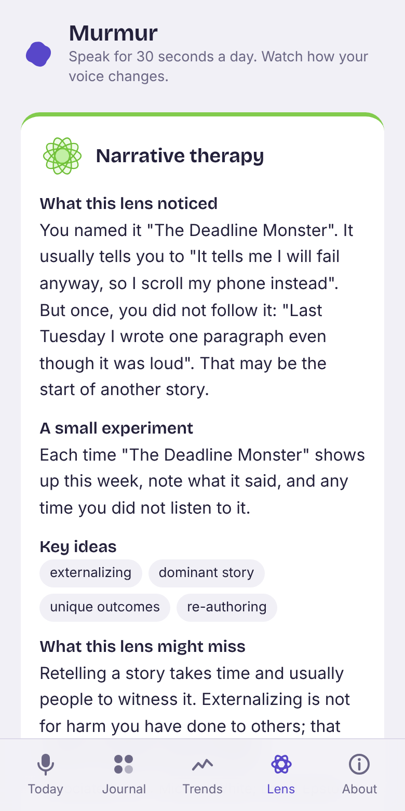
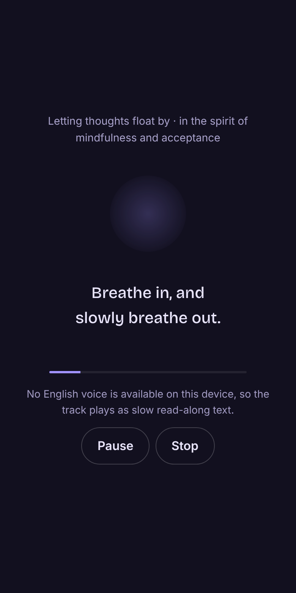
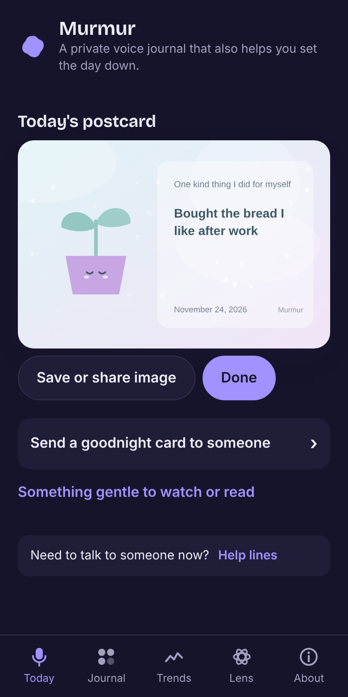
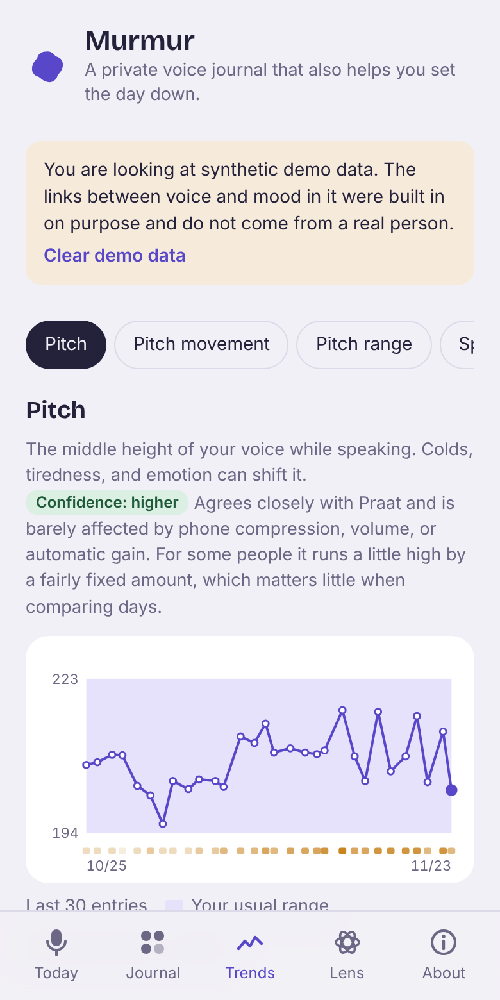

# Murmur · 低語日記

A private voice journal and wind-down companion that runs entirely in your browser. Speak for about 30 seconds a day, and Murmur measures your pitch, pitch movement, speaking rate, pauses, and voice regularity on your own device. Over time it shows how your voice changes compared with your own usual range, and, if you check in with a quick mood and energy rating, how your voice relates to how you feel.

**Try it:** https://jen900704.github.io/murmur-voice-journal/
(On a phone, add it to your home screen and it works like an app, including offline.)

[中文說明在下方](#中文說明)

<p>
  
  
  
  
  
</p>

The trend and journal screenshots use the app's built-in synthetic demo data.

## What is in it

- **Voice journal.** Speak for about 30 seconds; see pitch, pace, pauses, and voice regularity against your own usual range.
- **Theory lens.** Write down a worry and look at it through one of 14 counseling approaches (psychoanalytic, Adlerian, existential, person-centered, Gestalt, behavior therapy, mindfulness and acceptance, REBT, cognitive therapy, reality therapy, feminist, solution-focused, narrative, family systems). Each lens asks three or four questions in its own style, then shows what it noticed, a small experiment, key ideas, and what the lens might miss. Compare three lenses side by side, collect lens cards, and see which ones you rate as most helpful. This is psychoeducation, not counseling, and only techniques that are reasonable to try alone are included.
- **Bedtime ritual.** In the evening: set a worry down, note one kind thing you did for yourself, and listen to a three to five minute wind-down track in the style of a counseling approach suited to bedtime, read by your phone's own voice (or shown as slow read-along text). You get a pastel postcard to keep or share. Every step can be skipped, "Just listen" goes straight to a track, and there are no streaks.
- **Goodnight card.** Send one pastel card to one person through your phone's share sheet. It carries only a line you pick, never what you wrote; there is no feed, count, or read receipt.
- **Breathe for a minute.** A one-minute pacer (in for 4 seconds, out for 6) on Today and on the low-mood card.
- **Kindness jar.** The kind things you noted, kept privately. When a mood check-in is low, a few of them come back, along with three small general actions many people find a little helpful (not other users' posts, so there is nothing to compare against).
- **Daily prompt.** Everyone gets the same prompt on the same day, and you can swap answers with someone through a link.
- **AI conversation (experimental, off by default).** After a theory-lens exercise, continue as a conversation with an AI model that stays inside that approach: one reflection and one question per turn, the reasoning named, no praise or reassurance, only techniques suitable for self-help, and a stop with help lines if risk appears on either side. Uses your own API key.
- **Bedtime reminder.** Add a daily calendar event at a time you choose; Murmur sends no notifications.
- **Something gentle.** A short, curated list of films, short films, series, books, musicals, opera, and music, with content notes; heavier works are hidden unless you ask for them.

**Safety.** Text typed into the theory lens, the bedtime ritual, voice-entry notes, the prompt exchange, and the AI conversation is checked for signs that someone may be at risk (suicide, self-harm, harm to others, abuse) in Chinese and English. A match pauses and shows help lines for the person's region (Taiwan: 1925, 1995, 113, 110, 119, 1980; US: 988, the domestic violence hotline, 911; elsewhere: a link to findahelpline.com). Nothing is deleted: if the match was a false alarm, the person can carry on. Help is one tap away on every step. The check is a coarse safety net, tested against about 150 phrases, and will still miss some wording.

Plans and safety requirements for features that connect people are in [`docs/social-design.md`](docs/social-design.md). What is built, what needs review, and the idea backlog are in [`docs/roadmap.md`](docs/roadmap.md).

## Why

Speech features like pitch variability, speaking rate, and pausing appear throughout research on mood and mental health, but voices differ a lot between people. A number that is low for one person is ordinary for another. Murmur therefore never compares you with population norms. It compares you with yourself, and it lets you see whether your own voice tracks your own self-reports.

It is meant for self-reflection and for people curious about speech measurement. It is not a diagnostic tool.

## Privacy

- Audio is decoded and analyzed in the browser, in a Web Worker. Nothing is uploaded.
- Entries, recordings, theory-lens exercises you choose to save, bedtime notes, and settings are stored in IndexedDB on your device. There are no accounts, analytics, trackers, or third-party requests. The only network requests are for the app's own files.
- The one exception is an experimental AI conversation that continues a theory-lens exercise. It is off by default, needs your own Anthropic API key (stored unencrypted in this browser), and sends only that conversation, the worry, and your answers in that exercise to Anthropic. Voice entries and bedtime notes are never sent. The conversation is not saved on this device; Anthropic handles what it receives under its API data policy.
- You can keep only the measurements and not the audio (a setting), export a backup (JSON: measurements, notes, bedtime notes and saved exercises, as unencrypted text; audio is not exported) or the measurements as CSV, and delete everything at any time.
- Bedtime tracks use only voices that run on the device; online voices (such as Chrome's "Google" voices) are skipped, and the track falls back to read-along text.
- The help-line region you pick is kept in the browser's local storage. The site is hosted on GitHub Pages, which, like any web host, sees the IP address that loads it.
- Sharing is always your own choice, through your phone's share sheet: a postcard, a goodnight card, a prompt link (which carries only the prompt's number), or a backup file.

## What it measures

Each recording is resampled to 16 kHz mono, high-pass filtered at about 50 Hz to remove DC offset and rumble, and analyzed in 25 ms frames with a 10 ms hop.

| Feature | How it is computed |
|---|---|
| Pitch (Hz) | Median F0 over voiced frames. F0 from YIN (de Cheveigné & Kawahara, 2002): 0.15 threshold, 70 to 500 Hz range, parabolic interpolation on the difference function, and frames whose best period lies outside the range treated as unvoiced. Then 5-frame median smoothing, and removal of frames more than 1.8 times away from the median of their own 300 ms neighbourhood (octave errors). |
| Pitch movement (semitones) | Standard deviation of F0 in semitones. |
| Pitch range (semitones) | Distance between the 5th and 95th percentile of F0, in semitones. |
| Speaking rate (syllables/s) | Syllable nuclei divided by the time from first to last speech frame. Nuclei are intensity peaks at or near voiced frames that rise at least 2 dB above the preceding dip and are at least 80 ms apart, following de Jong & Wempe (2009). |
| Articulation rate (syllables/s) | Syllable nuclei divided by speaking time, excluding pauses. |
| Pause time (%) | Silent time between the first and last speech frame, as a share of that span. Silences shorter than 250 ms are not counted as pauses. |
| Average pause (s) | Mean duration of those pauses. |
| Loudness movement (dB) | Standard deviation of frame intensity over speech frames. Absolute loudness is not reported because it depends on the microphone and distance. |
| Voice regularity (dB) | 10·log10((1 − a) / a), where a is the lowest YIN aperiodicity within the pitch range, computed on every speech frame (voiced or not) and summarized by the median. Breathiness lowers it, but so do background noise and lossy recording, so it is only comparable across recordings made in similar conditions. It is related to, but not the same as, Praat's harmonics-to-noise ratio. |

Speech activity is found with an adaptive energy threshold placed between the recording's noise floor (5th percentile of frame energy) and its peak (99th percentile). A recording is rejected as "no speech" when fewer than 0.5 s of frames, or fewer than 20% of speech frames, are voiced, so noise or breathing alone is not saved.

**Recording conditions.** The app asks the browser to switch off echo cancellation, noise suppression, and automatic gain control, because they change pitch and loudness dynamics, and records at 128 kbit/s. Browsers do not always comply, so each entry stores the settings the browser actually applied, the container format, the share of clipped samples, and an SNR estimate (median speech energy minus the noise floor). Recordings with more than 1% clipped samples or an SNR below 15 dB are flagged, kept in the journal, and left out of baselines, trends, and correlations. Features are computed from the browser's compressed recording (Opus or AAC), not from raw PCM.

**What the evidence says about each feature.** Pitch is the best supported. Pause measures did well on clean read speech. Speaking rate, articulation rate, and pitch range should be read as rough, person-specific indices. Nothing here shows that any feature relates to mood.

**Personal baseline.** Once you have 10 usable recordings, a value is compared with the median of your *earlier* recordings, scaled by the median absolute deviation (MAD × 1.4826). With few recordings the median and MAD are themselves uncertain, so the cut-off depends on how many you have: k(n) = 1.96 + 9.5 / (n − 1) scaled MADs, which is 3.02 at 10 recordings, 2.42 at 20, and 2.04 at 100. This formula was fitted to simulations so that, when nothing has changed and values are roughly normal, about 5% of new values per feature are flagged as clearly higher or lower than usual at any history size. Unit tests check the rate at 10, 15, 30, and 100 earlier recordings. The shaded "usual range" on the trend chart uses the same cut-off.

**Voice and self-report.** Once 20 recordings have mood and energy ratings (1 to 7), Murmur shows Spearman correlations between each feature and each rating, with approximate 95% intervals from the Fisher z transform using the Bonett and Wright (2000) variance for Spearman's rho. A correlation is not shown when the feature has fewer than 5 distinct values or the ratings fewer than 3. The app says plainly that these are 18 correlations at once and that daily entries are not independent (shared drift, such as a week-long cold, inflates them), so the true uncertainty is larger than the intervals. Cells whose interval includes zero are greyed out.

**What gets pooled.** Synthetic demo entries are never mixed with your own: once you have one real entry, only real entries are used. Entries computed with an older version of the feature code are not pooled with newer ones.

## Validation

**Human speech (preregistered).** A protocol fixing metrics and thresholds was committed before any analysis ([`docs/validation-protocol.md`](docs/validation-protocol.md)). On 36 clips of recorded human speech, Murmur's pitch agrees closely with Praat (gross pitch error 1.8%, median fine error 4.6 cents) and pause detection found 39 of 39 pauses in 29 of 30 digit sequences. Voicing coverage, median pitch for some speakers, pitch range, and syllable counts missed their thresholds. Full results, including why, are in [`docs/validation-results.md`](docs/validation-results.md). A second preregistered study tested robustness to codecs, volume, automatic gain control, noise, reverberation, and telephone audio ([`docs/robustness-results.md`](docs/robustness-results.md)): phone codecs at 64 kbit/s and above, ±6 dB of gain, and automatic gain control left the features essentially unchanged, while background noise affected loudness movement, voice regularity, and the timing features. Every CSV column is defined in [`docs/codebook.md`](docs/codebook.md).

**Synthesized speech.** `tools/validate.sh` synthesizes English and Mandarin speech with eSpeak NG and compares Murmur with Praat (via Parselmouth) and with the known syllable count.

| File | F0 Murmur | F0 Praat | Syllables found | True syllables |
|---|---|---|---|---|
| English, 130 wpm | 92.9 | 92.0 | 30 | 34 |
| English, 160 wpm, higher pitch | 123.6 | 123.2 | 35 | 34 |
| English, 200 wpm | 92.3 | 91.8 | 19 | 34 |
| Mandarin (pinyin), slow | 90.7 | 89.5 | 35 | 32 |
| Mandarin (pinyin), fast | 90.7 | 89.5 | 29 | 32 |

Median F0 agrees with Praat within about 1 Hz. The syllable count is within about 12% at ordinary rates but undercounts very fast speech, where intensity dips between syllables become too shallow. Synthetic speech is a limited test; the human-speech results above are the main evidence. An exploratory pilot on two recorded Mandarin clips ([`docs/mandarin-pilot.md`](docs/mandarin-pilot.md)) found almost no gross pitch errors (0.2%), looser frame agreement than in English (median 22 cents), and a 4 to 6% higher median pitch that comes from frames Murmur alone counts as voiced (on frames both call voiced, the two agree to 0.1%). A steady difference like this does not affect comparisons with oneself.

The unit tests (`npm test`) cover YIN on harmonic tones from 90 to 380 Hz, rejection of a 600 Hz tone instead of reporting it at a subharmonic, pause and syllable detection on speech-like signals with known structure, robustness to noise and to a DC offset, rejection of noise-only audio, survival of real pitch excursions wider than an octave, voice regularity falling with added noise and with breathiness, clipping and noise flags, the direction of each feature under controlled changes, the false-flag rate of the baseline rule, and the statistics helpers against SciPy.

## Limitations

- Phone microphones, distance, background noise, and colds all change these numbers. Recording in a similar place and position each time helps.
- Browsers differ in how much audio processing they let an app turn off. Some iPhone models may still apply processing.
- Speaking rate is an estimate based on intensity peaks, not a transcript.
- Lexical tones in Mandarin (and other tone languages) raise pitch movement and pitch range by themselves. The usual range is only meaningful if recordings are in the same language.
- The correlations are descriptive and based on one person's data. They are leads to be curious about, not findings.
- If you speak with almost no silence at all, the noise floor is estimated from speech, which can make a recording look noisy or be rejected. Leaving a short pause at the start helps.
- Music, singing, or a TV in the background can pass the voicing check and produce numbers that are not about your speech.
- Safari on iPhone may clear site data after 7 days without a visit unless Murmur is used from the home screen, and the home-screen app keeps its data separately from Safari tabs. Exported backups contain measurements only, not audio.

## Run it locally

No build step and no dependencies.

```bash
git clone https://github.com/jen900704/murmur-voice-journal
cd murmur-voice-journal
python3 -m http.server 8080   # then open http://localhost:8080
npm test                      # unit tests (Node 18 or later)
npx playwright test           # browser tests: recording through a fake microphone, every feature,
                              # a mocked AI API, and an axe-core WCAG 2.1 AA audit of each screen
```

Microphone access requires `https` or `localhost`. The test suite needs no browser; `tools/validate.sh` additionally needs eSpeak NG, FFmpeg, and Python with `praat-parselmouth`.

```
index.html            app shell
js/features.js        feature extraction (pure functions, also runs in Node)
js/stats.js           baseline and correlation helpers
js/worker.js          runs the analysis off the main thread
js/recorder.js        microphone capture, decoding, resampling to 16 kHz
js/db.js              IndexedDB storage
js/viz.js             voice shapes and charts (SVG)
js/i18n.js            Traditional Chinese and English text
js/lenses.js          theory-lens content (14 approaches, zh-TW and en)
js/lens-view.js       theory-lens screens
js/safety.js          risk-language check and help lines
js/bedtime.js         bedtime scripts and the speech player
js/night-view.js      bedtime ritual screens
js/postcard.js        procedural postcards
js/extras.js          recommendations, nights, kindness jar, prompt exchange
js/prompts.js         daily prompts
js/ai-chat.js         experimental AI conversation (system prompt and safety rules)
data/recs.json        curated recommendations
sw.js                 offline cache
tools/validate.sh     comparison with Praat on synthesized speech
tools/make-demo.mjs   builds the synthetic demo data
```

The voice shape for each entry is the recording's pitch contour wrapped around a circle: the outline moves outward when pitch rises above that recording's median and inward when it falls, and loudness thickens it slightly.

## Demo data

The app can load 40 days of synthetic entries so you can see the trends and correlation views without recording for weeks. Those entries were made by running the real analysis on generated speech-like audio, and the relation between voice and mood in them was built in on purpose. The app labels them clearly and can remove them in one tap.

## If things are hard

Murmur is not a substitute for care. In the US, call or text 988. In Taiwan, call 1925 (安心專線, 24 hours).

## References

- de Cheveigné, A., & Kawahara, H. (2002). YIN, a fundamental frequency estimator for speech and music. *The Journal of the Acoustical Society of America, 111*(4), 1917–1930.
- de Jong, N. H., & Wempe, T. (2009). Praat script to detect syllable nuclei and measure speech rate automatically. *Behavior Research Methods, 41*(2), 385–390.
- Bonett, D. G., & Wright, T. A. (2000). Sample size requirements for estimating Pearson, Kendall and Spearman correlations. *Psychometrika, 65*(1), 23–28.

## License

MIT. The Bricolage Grotesque font is licensed under the SIL Open Font License (`fonts/OFL-bricolage.txt`).

Made by [Hsiang-Chen (Jen) Yeh](https://jen900704.github.io/jen-portfolio/).

---

## 中文說明

**功能。** 聲音日記之外，還有：換個角度看看（用 14 個諮商學派的提問方式看同一個煩惱，屬於心理教育，不是諮商）、睡前儀式（放下心事、寫下今天對自己好的一件事、聽一段三到五分鐘的睡前引導、收一張粉彩明信片；也可以「只想聽一段」直接開始）、寄一張晚安卡給一個人（卡片上只有你選的一句話）、呼吸一分鐘、對自己好的小罐子、每日小題交換，以及附內容提醒的溫和作品推薦。

**安全。** 輸入的文字如果出現自殺、自傷、傷人或受虐的訊號，會先暫停並顯示你所在地區的求助專線（台灣、美國或其他地方，可以切換）。寫下的內容不會被刪掉；如果只是誤判，可以按「我沒事，繼續」。每個步驟都能一鍵找到求助專線。這只是粗略的安全網，已用約 150 個句子測試，仍然可能漏掉某些說法。


Murmur 低語日記是一個完全在瀏覽器裡執行的聲音日記。每天說大約 30 秒的話，它會在你的裝置上算出音高、音高起伏、語速、停頓和聲音規律度。累積幾次之後，它會告訴你今天的聲音和你自己的平常範圍相比是高、低，還是差不多。如果你每次花兩秒標記心情和精神，它也會顯示你的聲音和你的感受之間的關聯。

**直接使用：** https://jen900704.github.io/murmur-voice-journal/
在手機上用 Safari 按「分享」→「加入主畫面」，就可以像 App 一樣使用，離線也能用。

**為什麼只跟自己比。** 音高起伏、語速、停頓這些特徵常出現在情緒和心理健康的語音研究裡，但每個人的聲音差異很大。對一個人來說偏低的數字，對另一個人可能很正常。所以 Murmur 不拿你和其他人比較，只拿你和你自己比較。

**隱私。** 錄音在瀏覽器裡解碼和分析，不會上傳。所有資料存在你裝置上的 IndexedDB，沒有帳號、沒有追蹤、沒有第三方請求。你可以選擇只保留數據不保留錄音，也可以隨時匯出或全部刪除。

**和自己比的規則。** 累積 10 筆可用的紀錄後，每筆新的數值會和你之前的紀錄比較（中位數加減 k 個標準化的 MAD）。紀錄少的時候中位數本身也不準，所以 k 會隨筆數調整：10 筆時是 3.02，100 筆時是 2.04。這個公式是用模擬校正的，在什麼都沒變的情況下，不論累積幾筆，大約都只有 5% 的數值會被標成「明顯比平常高或低」。爆音或背景噪音太大的錄音會保留，但不會拿來算平常範圍。聲音和心情的相關要等到有 20 筆標記後才顯示，並且會清楚說明同時看了很多個相關、每天的紀錄彼此不獨立，所以只能當作線索。

**它不是什麼。** Murmur 不是醫療器材，不做診斷。手機麥克風、距離、環境噪音、感冒都會影響數字，每次在差不多的地方、用差不多的姿勢錄，結果會比較穩定。中文的聲調本身會讓音高起伏和音域變大，所以最好每次都用同一種語言錄。

**驗證。** 先公開登錄分析計畫，再用 36 段真人英文錄音和 Praat 比較：音高很接近（嚴重音高錯誤 1.8%，細部誤差中位數 4.6 cents），停頓偵測在 30 組數字串中有 29 組完全正確。有聲段覆蓋率、部分說話者的音高中位數、音高範圍和音節數沒有達到事先訂的標準，原因寫在 `docs/validation-results.md`。另一個登錄過的研究測試了壓縮、音量、自動增益、噪音、回音和電話音質：64 kbit/s 以上的壓縮、±6 dB 音量和自動增益幾乎沒有影響，背景噪音則會影響響度起伏、聲音規律度和時間相關的特徵。另外用兩段中文真人錄音做了探索性的小測試（`docs/mandarin-pilot.md`）：音高幾乎沒有嚴重錯誤（0.2%），逐格誤差比英文大（中位數 22 cents，仍遠小於半音），Murmur 回報的音高中位數比 Praat 高 4 到 6%，原因是有些 Praat 判為無聲的音框被 Murmur 算成有聲；兩邊都算有聲的音框則幾乎完全一致（差 0.1%）。因為只跟自己比，這種穩定的差異不影響「比平常高或低」的判斷。真正的中文驗證還需要台灣使用者日常用手機錄的聲音。

**資料可能會不見的情況。** iPhone 的 Safari 如果超過 7 天沒打開這個網站，可能會清掉資料，加入主畫面後使用可以避免；主畫面 App 和 Safari 分頁的資料是分開的；匯出的備份只有數據，沒有錄音檔。

如果你最近過得很辛苦：台灣可撥安心專線 1925（24 小時），美國可撥打或傳訊 988。
