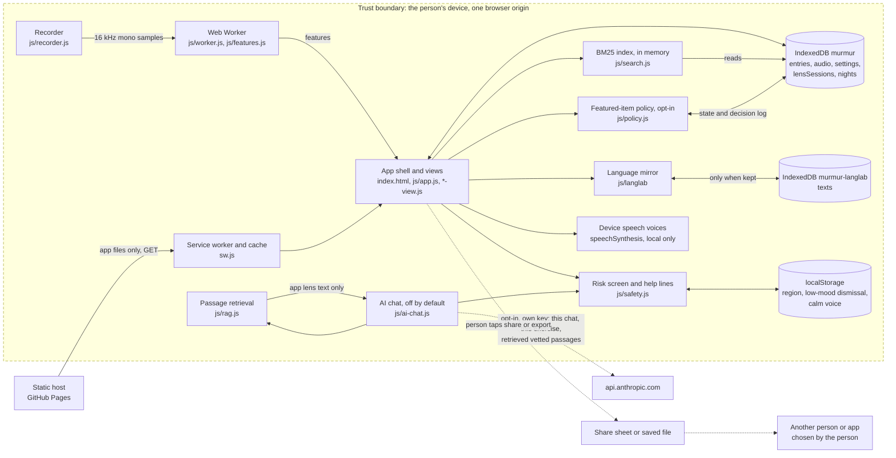
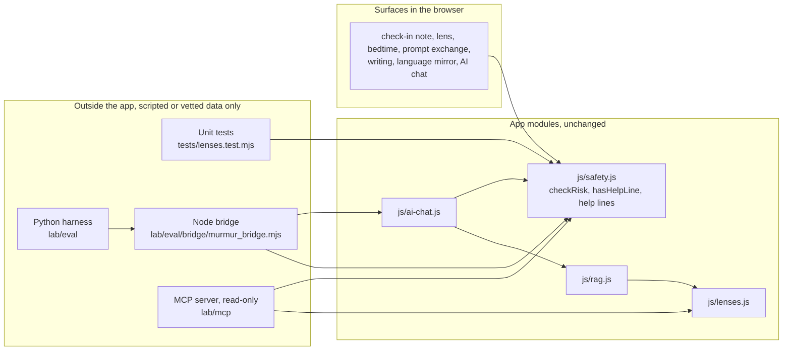

# Murmur 低語日記: architecture

Written 2026-11-24 from the code in this repository. Test counts in section 4 were counted from the test files on that date. Where a README and the code disagree, this page follows the code and says so.

## 1. Summary and privacy boundary

Murmur is a static web app (a PWA hosted on GitHub Pages) made of plain ES modules with no build step and no runtime dependencies. A person records about 30 seconds of speech, and the app measures pitch, pace, pauses and voice regularity in a Web Worker, stores the result in IndexedDB, and compares it with that person's own earlier recordings. Around the voice journal are text-based self-help flows (theory lenses, a bedtime ritual, a calm flow, a writing mode, a language mirror), a journal search, and an optional featured-item learner. One deterministic risk screen (`js/safety.js`) is called by every surface that takes free text. There is no server, no account, and no analytics. The research modules under `lab/` and the Terraform under `infra/` study the app from outside; the app never loads them or talks to them.

### What runs on the device

Everything the app does: audio capture, decoding, resampling and feature extraction; the baseline and correlation statistics; the risk screen; search indexing and retrieval; the bandit policy and its decision log; the language analysis and its report; bedtime speech (only voices the browser reports as local; `pickVoice` in `js/bedtime.js` drops any voice with `localService === false`); postcards (procedural SVG rendered to PNG). Storage is IndexedDB and three `localStorage` keys in the same browser profile.

### What can leave, and only by the person's choice

| Route | What it carries | Code |
|---|---|---|
| Share sheet | A postcard or goodnight card image with a line the person picked; a prompt link whose hash holds only the prompt's number (`#ask=N`); a prompt answer the person chose to share | `js/postcard.js` `sharePng`, `js/extras.js`, `js/app.js` `parseAsk` |
| Saved or shared files | Backup JSON (entries, nights, saved lens exercises, lens ratings, and the policy log and state when used; unencrypted, no audio); voice entries as CSV; the policy decision log as CSV; the language evidence report (HTML and JSON, without the text itself); a calendar file for the bedtime reminder | `js/app.js` `exportJson`, `saveFile`; `js/policy.js` `decisionsCsv`; `js/langlab/report.js` |
| Optional AI chat | Off by default, needs the person's own Anthropic API key. Sends that one conversation, the worry and answers of that one lens exercise, and a few passages of the app's own reviewed lens text. Nothing from the journal | `js/ai-chat.js` `callModel`, `js/rag.js` |

Nothing else is sent. The Content-Security-Policy in `index.html` enforces part of this: `connect-src 'self' https://api.anthropic.com`, `script-src 'self'`, `form-action 'none'`, `object-src 'none'`. Two things are outside the app's control and are stated in the README: the web host sees the IP address that loads the app's files, and tapping a help line opens the phone dialer or, for the "elsewhere" region, findahelpline.com.

Solid arrows stay on the device or fetch the app's own files. Dashed arrows cross the trust boundary and happen only after an explicit action by the person.

## 2. Module map

### App shell and routing

`index.html` is a fixed shell: skip link, header, `<main>`, a sheet container, a tab bar, a toast and a screen-reader live region. It loads `js/app.js` as a module and preloads the other modules.

`js/app.js` (about 1,850 lines) owns one in-memory `state` object and a `render()` function that rebuilds the current view with a small element helper `h`. Routing is the URL hash: five tabs (`today`, `journal`, `trends`, `lens`, `about`), `#entry` for an open detail sheet so that Back closes it, and `#ask=N` for a shared prompt link, which is read once and replaced with `#today`. Feature views are factories that receive what they need (`h`, `db`, `getLang`, `openSheet` and so on) instead of importing the shell: `createLensView`, `createNightView`, `createExtras`, `createJournalSearch`, `createLanguageView`. Heavier or rarely used modules load on first use with dynamic `import()`: `language-view.js` and `js/langlab/*`, `writing.js`, `policy.js`.

### Storage

`js/db.js` wraps one IndexedDB database, `murmur`, version 3:

| Store | Key | Holds |
|---|---|---|
| `entries` | `id` (index on `createdAt`) | Voice entries (features, quality flags, ratings, note, prompt) and silent check-ins or writing entries (`silent: true`, `features: null`) |
| `audio` | entry id | The recording as an ArrayBuffer plus MIME type; absent when the person keeps measurements only |
| `settings` | setting name | `lang`, `keepAudio`, `welcomed`, `installNoted`, `lastBackup`, `nightKeep`, `lensStats`, `aiEnabled`, `aiKey`, `aiModel`, `policyOptIn`, `policyState`, `policyLog`, `policyRiskAt` |
| `lensSessions` | `id` | Lens exercises the person chose to save |
| `nights` | `id` | Bedtime ritual records; the worry text only if the person left "keep" on |

`db.js` also handles browsers that never answer an open request: after 4 seconds the app carries on without storage and says so, and retries later. A transaction whose callback throws is aborted so nothing half-written is kept.

`js/langlab/store.js` uses a second database, `murmur-langlab` (one store, `texts`), so imported writing sits apart from the journal. It is written only when the person presses "keep". "Delete everything" in About clears both databases.

`localStorage` holds three small keys: `murmur-region` (help-line region), `murmur-low-dismissed` (which low-mood note was dismissed) and `murmur-calm-voice` (voice on or off in the calm flow).

`js/validate.js` checks every record of an imported backup (`cleanEntry`, `cleanNight`, `cleanSession`) before it reaches a store.

### Audio pipeline

1. `js/recorder.js` asks for the microphone with echo cancellation, noise suppression and automatic gain control switched off, records with `MediaRecorder` (MP4/AAC first on Apple browsers, Opus elsewhere), and `decodeToMono16k` decodes and resamples to 16 kHz mono. The settings the browser actually applied are stored with the entry.
2. `js/app.js` posts the samples to `js/worker.js`, an 11-line module worker that calls `analyze()` from `js/features.js`. If the worker cannot start, fails, or takes more than 20 seconds, the same function runs on the main thread.
3. `js/features.js` is pure and also runs in Node. It high-pass filters, frames at 25 ms with a 10 ms hop, finds speech with an adaptive energy threshold, estimates F0 with YIN (threshold .15, 70 to 500 Hz, parabolic interpolation, median smoothing, octave-error removal), counts syllable nuclei from intensity peaks, measures pauses of 250 ms or more, and computes voice regularity from YIN aperiodicity. It also returns quality flags (clipping, low SNR). `FEATURE_VERSION` is stored with each entry, and entries from another version are not pooled.
4. `js/stats.js` holds the personal baseline (median and scaled MAD of earlier recordings, with a cut-off `k(n) = 1.96 + 9.5 / (n - 1)`) and Spearman correlations with ratings. `js/viz.js` draws the voice shape and the trend chart as SVG.

### Safety layer

`js/safety.js` is the single risk screen. `checkRisk(text)` normalizes the text (NFKC, curly apostrophes, spaces between Chinese characters) and tests it against regular-expression lists in three kinds (`self`, `others`, `abuse`) in Chinese and English, with `notAfter` guards for common false alarms. It returns `{ risk, kinds }` and nothing probabilistic. No lookbehind is used, because one unsupported regex in this file would stop the whole app from loading on older Safari.

Call sites, all importing the same function: check-in notes (`app.js`), the lens exercise (`lens-view.js`), the bedtime ritual (`night-view.js`), the prompt exchange (`extras.js`), writing mode (`writing.js`), imported text in the language mirror (`language-view.js`), and both directions of the AI chat (`ai-chat.js`). A match pauses and shows help lines; nothing is deleted and the person can continue. In the lens exercise, the ritual, the prompt exchange, writing mode and the AI chat, a match also calls `noteRisk()` in the policy store, which gates the learner for 36 hours.

The same file holds `hasHelpLine()` (a number next to a word such as call or 專線, used to judge AI replies), the help lines for three regions (`TW`, `US`, `other`), a region guess from the time zone, and `helpList()`, the UI component every surface reuses.

The risk screen is tested in three places. `tests/lenses.test.mjs` runs it against the labeled phrases (about 210). `lab/eval` runs scripted conversations through the app's real `ai-chat.js`, `rag.js` and `safety.js` in Node via `lab/eval/bridge/murmur_bridge.mjs`, which replaces `fetch` with a stand-in so nothing touches the network, and cross-checks the gate's result against what `send()` did. `lab/mcp` exposes the same `checkRisk` as a read-only tool and tests that every match returns help lines.

### Theory lenses and AI chat with retrieval

`js/lenses.js` is content plus a few pure helpers: 14 approaches in zh-TW and English, each with an idea, questions with a reason for each, a summary template, an experiment, concepts and "what it might miss"; `lensesForTopic` (only five lenses for loss) and `TOPIC_COMMON` (the expert order). `js/lens-view.js` drives the exercise, the compare and draw-a-card modes, saving, and ratings.

`js/ai-chat.js` continues an exercise as a chat. It builds a system prompt per lens (allowed moves and moves to avoid), fences the person's earlier notes inside `<person_notes>`, and calls `https://api.anthropic.com/v1/messages` directly from the browser with the stored key. Guards in code: risk words in the outgoing message pause before sending; an empty or refused reply ends the chat with help lines; a reply that matches the risk screen without a help line is held back; a reply with a help line ends the chat; ten user turns at most. The conversation lives in memory only.

`js/rag.js` cuts the lens content into passages with ids (idea, concepts, misses, one per question reason) plus one help-line passage for the region, ranks the current lens's passages against the latest message with the BM25 index from `js/search.js`, keeps three, and appends them to the system prompt inside `<murmur_reference>`. It does not import storage. Reply citations such as `[cognitive.idea]` are stripped before display and turned into a "Based on" line. Details and limits are in [`search-and-rag.md`](search-and-rag.md).

### Bedtime ritual and speech player

`js/bedtime.js` holds nine track scripts, the theme-to-track mapping, and `BedtimePlayer`, which plays a script line by line through `speechSynthesis` with timed pauses, or as timed read-along text when there is no local voice or speech is off. `js/night-view.js` runs the ritual steps (worry, one kind thing, track, postcard), always in the dark palette. `js/postcard.js` draws the postcard and shares it as a PNG. The calm flow reuses `pickVoice` from this module, so the local-voice rule applies there too.

### Search

`js/search.js` is a dependency-free BM25 engine (k1 = 1.2, b = .4) over weighted fields. Tokens are stemmed Latin words, digit runs, and single characters plus neighbouring pairs for Chinese, Japanese and Korean text. A 26-group bilingual synonym table, a phrase boost and a small recency factor adjust scores. The journal index is built in memory from IndexedDB when the Journal opens and is never written anywhere; snippets are returned as plain and matched pieces so the view inserts text nodes, not markup. The same engine indexes lens passages for `rag.js`.

### Bandit policy

`js/policy.js` chooses ONE featured item on three surfaces: the lens shown first for a topic, the suggested bedtime track, and the small action on the low-mood note (always gated, so always the expert's first). It is opt-in and off by default; opted out, nothing is decided or logged. The model is one Beta-Bernoulli posterior per surface, context and arm with a prior that follows the expert order. A decision mixes the greedy arm with an exploration distribution (EPS = .20, KAPPA = .25, Thompson probabilities estimated by 1,000 seeded Monte Carlo draws), and the action is drawn from the exact probability vector that is logged. Ineligible arms are removed before sampling. A gate (recent risk match, low latest mood, or the loss topic) forces the expert's first item with probability 1 and no learning. Evidence is discounted by .98 per rated session. State and log live in the `settings` store and can be exported as CSV. The contract is [`lab/rl/POLICY_SPEC.md`](../lab/rl/POLICY_SPEC.md); note that section 1 of that spec still says the track surface stays off in the app, while `js/night-view.js` now decides and logs a track when the person has opted in.

The recommendation list ("Something gentle") is not part of the bandit. `js/extras.js` orders it with fixed rules from the time of day and the latest check-in.

### Language mirror

The view is `js/language-view.js`, reached as a mode of the Journal tab. The engine is `js/langlab/`:

- `tokenize.js`: masks URLs, e-mail addresses, mentions and hashtags; splits Latin words and numbers; segments Chinese by longest match against the lexicon's own word list, so results do not depend on the browser's `Intl.Segmenter`. Every token keeps its position in the original text.
- `lexicon-en.js`, `lexicon-zh.js`: hand-written category word lists with version strings, plus a guard list for Chinese (for example 不錯 is not a negation). `vader.js` with `data/lexica/vader.json` gives English sentence sentiment. `score.js` has a code path for Empath topics, but no Empath data is bundled, so it does not run.
- `score.js`: a category score is hits per 100 units (words in English, Han characters divided by 1.5 in Chinese). Indices are plain sums and differences of category rates. Minimum text lengths gate each tier. Intervals at 90% come from a seeded bootstrap over items or sentences, or a Wilson interval when there are too few units. It also produces the words behind each score, highlight spans, a time series and a comparison with kept earlier text.
- `importers.js`, `zip.js`: readers for pasted text, .txt, .md, .csv, .json, and the official exports of Instagram, Facebook, Threads, X, Bluesky (.car) and Reddit. Zip archives are opened with the browser's `DecompressionStream`; `wantedInArchive` picks posts and comments and skips messages, ads and account files.
- `report.js`: the evidence report as one self-contained HTML page and one JSON file, with method, lexicon versions and licenses, every score with its interval and contributing words, limits and references. It does not contain the text.
- `meta.js`: labels, notes on what each category cannot tell, references. `store.js`: the separate database described above.

The analysis currently runs on the main thread after a short yield so the "working" line can paint. The design brief ([`language-analysis/DESIGN.md`](language-analysis/DESIGN.md)) describes a worker and a finer file split (`normalize.js`, `count.js`, `explain.js`, `series.js`, `safety-bridge.js`) that the code has folded into the files above.

### Calm and writing flows

`js/calm.js` is one sheet: paced breathing (delegated to `js/breathe.js`), then 5-4-3-2-1 grounding one step per screen, then self-compassion phrases, with an optional local voice. It takes no free text, so it does not call the risk screen, but it shows the help list. `js/breathe.js` is also the one-minute pacer on Today.

`js/writing.js` offers prompts by weight (light, middle, deep). Deep prompts follow Pennebaker's expressive writing with a 15-minute timer and a short closing. A saved text is an ordinary entry in the silent check-in shape, so it appears in the journal and in search but never in voice trends. The text is screened before saving.

### Service worker and release

`sw.js` precaches a fixed list (`SHELL`) into one cache named `murmur-<hash>`. On install each file is fetched with `?v=<cache name>` and `cache: 'reload'` so a CDN edge cannot return an older copy, and any failure fails the install. Fetch handling is cache-first from that one cache, with `index.html` as the navigation fallback and a small bilingual offline page (with help lines) if nothing was ever cached. `activate` deletes other `murmur-*` caches.

Release is one command, `npm run prepare-release`: `tools/export-content.mjs` regenerates `docs/content-review.md`, and `tools/bump-cache.mjs` sets the cache name to the first 10 hex characters of a SHA-256 over every file in `SHELL` plus `sw.js` itself. A unit test fails if either is stale.

Updates apply only when idle. `setupUpdates()` in `js/app.js` registers the worker (on HTTPS, or on localhost only with `?sw`), and sends `skip-waiting` to a waiting worker only when `isIdle()` holds: not recording, no ritual or lens exercise in progress, no open sheet, and no text typed in any field. On `controllerchange` the page reloads once, again only when idle. A page therefore never runs files from two releases, and nothing being typed or played is interrupted.

### Accessibility

The approach is semantic HTML built by hand plus a test that audits it. The shell has a skip link, a labelled tab `nav`, a focusable `main`, and two polite live regions (toast and `#sr-live`). `render()` remembers the focused element by `data-key` and restores it after a rebuild; sheets return focus on close; Escape closes a sheet. Custom radio groups get roving tabindex and arrow keys (`enhanceRadios`). Search results are announced through a status region. CSS covers light and dark schemes and reduced motion. `tests/e2e/a11y.spec.mjs` runs axe-core against WCAG 2.1 A and AA on 20 screens, each once in Chinese with light colors and once in English with dark colors.

### i18n

Two languages, Traditional Chinese (`zh-TW`) and English. `js/i18n.js` holds the shell's strings and `t(key, ...args)`; the language is detected from the browser on first visit and then stored in the `settings` store. Feature modules carry their own two-language tables next to their code (for example `S` in `ai-chat.js` and `language-view.js`), and content modules (`lenses.js`, `bedtime.js`, `prompts.js`, `writing.js`) store both languages per item. The risk screen and search treat both languages in one pass because people here mix them. Help lines follow region, not language.

## 3. Key design decisions

### ADR 1. Vanilla JavaScript, no build step

- Context: a small app by one author that must stay readable by reviewers who are not front-end engineers, and whose pure modules are also run by Node tests, a Python harness and an MCP server.
- Decision: plain ES modules served as written. No framework, bundler, transpiler or runtime dependency. The only dev dependencies are Playwright and axe-core.
- Alternatives rejected: a framework with a bundler (adds a toolchain between the source and what runs, and the lab modules could no longer import `js/*.js` directly); TypeScript (same toolchain cost).
- Consequences: what is in the repository is what the browser runs, and the service worker can hash exact files. The cost is manual DOM code, a large `app.js`, no type checking, and a hand-kept `SHELL` list in `sw.js`.

### ADR 2. On-device only

- Context: voice recordings and private writing about worries, from a counseling student's project with no ethics approval to hold other people's data.
- Decision: all processing and storage in the browser. No backend, account, analytics or third-party request. The CSP limits connections to the app's origin and the one opt-in API host.
- Alternatives rejected: a sync server or cloud analysis (creates a data holder and a breach surface); server-side speech models (audio would leave the device).
- Consequences: the privacy claim is checkable from the source and the CSP. The costs: data lives on one device and Safari may clear it (hence backups and reminders); no cross-device sync; features are limited to what runs in a browser; the AI key is stored unencrypted in IndexedDB.

### ADR 3. A deterministic safety screen, not a model

- Context: free text can contain signs of risk. The response (pause and show help lines) must behave the same on every surface, offline, on old phones, and must be testable phrase by phrase.
- Decision: regular-expression lists with guard patterns in one file, returning a boolean and kinds. A match never deletes or blocks; it pauses with help and lets the person continue. Help lines are also one tap away everywhere, because the screen will miss things.
- Alternatives rejected: an ML or LLM classifier (would need a download or a network call, is not reproducible across versions, and cannot be reviewed line by line by a clinician); no screen at all.
- Consequences: behaviour is auditable, identical in the app, the eval bridge and the MCP server, and each new miss becomes a new test phrase. Recall on indirect wording is limited: in the committed mock run the screen pauses on 9 of 16 scripted risk messages. It covers Chinese and English only.

### ADR 4. Lexicon counts for the language mirror, not an ML or LLM classifier

- Context: the feature is for reflection on one's own writing. The literature in [`language-analysis/LITERATURE.md`](language-analysis/LITERATURE.md) shows small links between word categories and traits, so any score needs to be explainable and modest. LIWC and C-LIWC cannot be bundled ([`language-analysis/LICENSES.md`](language-analysis/LICENSES.md)).
- Decision: counts over hand-written, versioned word lists (MIT), with VADER (MIT) for English sentiment. Each number links to the exact words that produced it, has an interval, and has a stated limit. No personality or mental-state scores.
- Alternatives rejected: a trained classifier or embedding model (no word-level explanation, model weights to ship, licensing questions); an LLM call (text would leave the device); bundling LIWC (license).
- Consequences: "the explanation is the model", and results are deterministic given the lexicon and engine versions. Scores are not comparable with published LIWC values, open-class lists are incomplete, sarcasm and context are missed, and Chinese segmentation is only as good as the word lists.

### ADR 5. A featured-item bandit with logged propensities, not a learned ranking

- Context: a person gives about one helpfulness rating a day. The question worth asking is whether learning from those ratings beats the expert order at all.
- Decision: learn only which single item to feature; leave the rest in expert order. Safety filtering and gating happen before sampling. Log the full probability vector and the exact propensity of each decision so the log can be evaluated off-policy. Opt-in, off by default.
- Alternatives rejected: learning a full ranking (14 items have about 87 billion orders, the propensity of a ranking is impractical to compute, and one rating cannot be attributed to 14 positions); silent personalization without a log.
- Consequences: the worst outcome is a less suitable but still eligible item shown first. The log supports IPS, SNIPS and doubly robust estimates in `lab/rl`. The preregistered simulation found that learning does not beat the expert order within 90 interactions in the primary world, so the default stays the expert order, and adaptive logs do not support the usual confidence intervals.

### ADR 6. BM25 on the device, not embeddings

- Context: search over a few dozen to a few thousand short private notes in mixed Chinese and English, and retrieval over 87 lens passages.
- Decision: an in-memory BM25 index with character bigrams for Chinese and a small synonym table, about 700 lines, no dependencies.
- Alternatives rejected: an on-device embedding model (tens of megabytes to download and cache, slower on phones, opaque ranking); a hosted embedding API (text would leave the device).
- Consequences: instant, offline, explainable ranking with exact highlighting. It misses paraphrases (one of the 20 evaluation queries returns nothing), has no typo tolerance, and does not match Simplified to Traditional characters. On the labeled set MRR is .950 and nDCG@5 is .846; that set was written by the engine's author and is a regression check only.

### ADR 7. The eval harness runs the app's real code through a Node bridge

- Context: evaluating the AI conversation needs the exact system prompt, notes fence, retrieval, risk pause, reply hold and turn limit. A Python copy of those would drift.
- Decision: `lab/eval/bridge/murmur_bridge.mjs` imports `js/safety.js`, `js/lenses.js`, `js/rag.js` and `js/ai-chat.js` unchanged, drives `createAiChat().send()`, and replaces `fetch` so the request the app built is handed to the Python orchestrator, which returns a model reply (Anthropic, Bedrock or a mock).
- Alternatives rejected: re-implementing the prompt and safety rules in Python; driving a real browser for every case (slow, and harder to intercept model calls).
- Consequences: a change in the app changes what is evaluated, with source hashes recorded per run; if the bridge cannot follow a change, tests fail. This is possible only because of ADR 1. Only the mock provider has been run from this repository.

### ADR 8. Terraform for evaluation infrastructure only

- Context: scheduled evaluation runs against Bedrock need compute, a results bucket and cost guards. The app itself needs none of that.
- Decision: `infra/` defines an ECS Fargate task with a role limited to `bedrock:InvokeModel` on named models and writes under `runs/` in an encrypted bucket, a disabled-by-default schedule, a budget alarm, a GitHub OIDC role, and an optional static-site module. The app never talks to any of it.
- Alternatives rejected: any backend for the app (ADR 2); AWS Batch (more moving parts than one weekly container needs); long-lived AWS keys in the repository.
- Consequences: the privacy boundary is unchanged, since only synthetic test cases reach AWS. Nothing has been deployed; the code was checked with OpenTofu, tflint and checkov without an account, and the image has not been built.

### ADR 9. The MCP server is read-only

- Context: exposing the vetted lens content, help lines and risk screen to MCP clients is useful; exposing a person's journal is not acceptable.
- Decision: `lab/mcp/server.mjs` imports the app's content modules and offers seven read-only tools and six resources over stdio. No storage, network code or logging. Every result carries a scope note, and `check_risk` always returns help lines on a match and never echoes the text.
- Alternatives rejected: tools that read or write journal data; an HTTP server.
- Consequences: the app stays the single source of truth and the server cannot become a second place where private text lives. Tests check the source for file writes, network calls, child processes and logging. One rule (the heavy-content list) is read from `js/extras.js` as text and fails closed if not found.

## 4. Testing and CI

Counts were taken on 2026-11-24 by running the unit files and listing the Playwright tests; lab counts are the number of `test_` functions or `test()` calls in the files.

| Layer | What it covers | Count | How to run |
|---|---|---|---|
| Unit (Node, no browser) | `tests/features.test.mjs` 24, `stats.test.mjs` 13, `lenses.test.mjs` 238 (risk phrases, lens and bedtime content, backup validation, content review and cache name freshness), `search.test.mjs` 30, `policy.test.mjs` 18, `langlab.test.mjs` 39, `writing.test.mjs` 12 | 374 checks in 7 files | `npm test` (Node 18 or later) |
| Browser, Chromium | Recording through a fake microphone, main flows, mocked AI API, search, policy, language mirror, calm, writing | 193 tests in 14 spec files, including the three rows below | `npm ci && npx playwright install chromium && npm run test:e2e` |
| Accessibility | axe-core, WCAG 2.1 A and AA, 20 screens in two settings (`a11y.spec.mjs`) | 40 | part of the browser run |
| Offline | Load, go offline, reload through the service worker (`offline.spec.mjs`) | 1 | part of the browser run; skipped in WebKit |
| Robustness | Double taps, damaged backups, storage failures, long text, clock changes, back button (`robust.spec.mjs`) | 47, of which 2 are marked `test.fail()` for the open Back-button bug | part of the browser run |
| Browser, WebKit | The same specs without `record.spec.mjs` and `noise.spec.mjs` | 187 tests in 12 files | `npx playwright install webkit && npm run test:webkit` |
| Lab: eval harness | Schema, statistics, judge parsing, agreement, safety parity with the app, mock end to end | 60 | `python3 -m unittest discover lab/eval/tests` |
| Lab: bandit and OPE | Spec constants, safety audit, propensities, estimators | 29 | `python3 -m unittest discover lab/rl/tests` (needs NumPy) |
| Lab: DLATK pipeline | Parsing, grouping, n-grams, lexicon scores, BH, parity with the committed DLATK output | 29 | `python3 -m unittest discover lab/dlatk/tests` |
| Lab: MCP server | Tool outputs against app modules and schemas, read-only checks | 17 | `cd lab/mcp && npm ci && npm test` |
| Search evaluation | 20 labeled queries; fails below MRR .85 or nDCG@5 .80 | 1 script | `node tests/search-eval.mjs` (not in CI) |
| Infra | Plan-level tests with a mocked provider | 7 runs | `tofu test` or `terraform test` in `infra/` (not in active CI) |

`.github/workflows/test.yml` runs four jobs on every push and pull request: `unit`, `lab` (the four lab suites), `browser` (Chromium) and `webkit`. Playwright retries once in CI and pins the time zone to Asia/Taipei so help lines do not depend on where the tests run. `.github/workflows/infra.yml.draft` is inactive by name. The Praat comparisons (`tools/validate.sh`, `tools/validate_human.py`, `tools/robustness.py`) need eSpeak NG, FFmpeg and Parselmouth and are run by hand; their results are in `validation-results.md` and `robustness-results.md`.

The CHANGELOG entry for 2026-11-24 gives 228 unit checks and 93 browser tests; those numbers predate the search, policy, language mirror, calm and writing suites.

## 5. Known limitations and open work

Voice measures

- Pitch agrees closely with Praat. Voicing coverage, median pitch for some speakers, pitch range and syllable counts missed their preregistered thresholds ([`validation-results.md`](validation-results.md)). Speaking rate undercounts fast speech.
- Background noise changes loudness movement, voice regularity and timing features ([`robustness-results.md`](robustness-results.md)). Music or a TV can pass the voicing check.
- Features are computed from the browser's compressed recording, and browsers do not always honour the request to switch processing off.
- Mandarin validation is a two-clip exploratory pilot. Lexical tone raises pitch movement and range, so a usual range mixes badly across languages.
- No evidence here shows that any feature relates to mood. The correlations are descriptive, 18 at once, on autocorrelated daily data from one person. The self-study in [`self-study-protocol.md`](self-study-protocol.md) has not been run.

Safety

- The risk screen is a coarse net: Chinese and English only, limited recall on indirect wording, no Taiwanese Hokkien or mixed-language coverage in the eval cases, and some false alarms.
- AI chat safety is instructions to a model plus pattern checks, not a guarantee. The Anthropic and Bedrock providers of the eval harness have not been run against live services; no confirmatory run and no human annotation exist yet. Cases and rubrics are first drafts awaiting review.
- Retrieval makes it more likely that theory statements match reviewed text; the model can still say things found in no passage.

Content and review

- Lens questions, bedtime scripts, several Chinese terms and the recommendation list (seven works without a confirmed Taiwan title) still need review by the owner and a supervisor ([`roadmap.md`](roadmap.md), [`reviewer-brief.md`](reviewer-brief.md)).
- Real-device checks on an iPhone (speech voices, share sheet, Home Screen storage) cannot be done in CI and are still listed as to do.

App

- The phone's Back button inside the bedtime ritual and a lens exercise leaves the flow instead of going one step back (two `test.fail()` tests document it).
- Safari may clear site data after seven days without a visit unless the app is on the Home Screen; the Home Screen app keeps separate data. Backups are unencrypted and exclude audio.
- The AI key is stored unencrypted in the browser.
- `sw.js` needs its `SHELL` list kept by hand; a module missing from it works online but not offline.
- No Japanese interface; it would first need Japanese risk patterns and verified help lines.
- Social features are design notes only ([`social-design.md`](social-design.md)).

Search and language mirror

- Search does not match paraphrases, typos, or Simplified to Traditional characters, and its evaluation set is small and author-written.
- Language mirror: analysis runs on the main thread (the design calls for a worker); no Empath data is bundled; lists are incomplete by nature; scores are not LIWC scores; the preregistration and release gates in section 15 of the design brief are not yet met by any recorded study.
- The app's categories have not been exported as a lexicon for the DLATK pipeline, so the two analyses use different word lists.

Policy and research modules

- The simulation's users were not fitted to anyone. Ratings are missing not at random. Offering exploration to anyone but the owner needs ethics review and consent. `POLICY_SPEC.md` section 1 and the app differ on whether the track surface is active.
- DLATK was designed for many people; here the groups are one person's weeks or months. The fallback engine tokenizes Chinese by character.
- The MCP server reads one rule from `js/extras.js` as source text.
- Infrastructure: nothing deployed, HashiCorp Terraform itself not run, image not built; the default task command in `infra/README.md` is an assumption and does not match `lab/eval/run_eval.py`.
