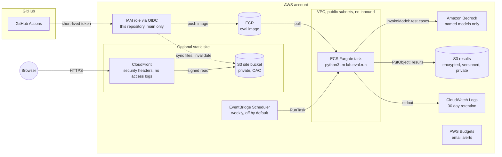

# Murmur lab infrastructure (Terraform, AWS)

Terraform for two things around the app, neither of which the app needs in order to work:

1. **eval-runner.** A scheduled container that runs the evaluation harness in `lab/eval` against models on Amazon Bedrock and saves the results.
2. **static-site** (optional, off by default). A second way to host the PWA, on a private S3 bucket behind CloudFront. GitHub Pages already hosts it.

There is also a role that GitHub Actions can assume through OIDC, so no AWS access keys are ever stored in the repository.

Nothing has been deployed. This folder was written and checked without an AWS account (see "What was checked").

## What data goes where

Murmur's promise is that what a person says or writes stays on their device. This infrastructure does not change that, because the app never talks to it.

| Place | What it holds | What it never holds |
| --- | --- | --- |
| Container image (ECR) | The public code in `lab/eval`, `js/` and `data/` | Anything from a user |
| Amazon Bedrock | Prompts built from the synthetic test cases in `lab/eval/cases`, sent by the eval task | Journal entries, recordings, check-ins |
| Results bucket (S3) | Model outputs and scores for those test cases | Anything from a user |
| CloudWatch Logs | What the eval task prints | Anything from a user |
| Site bucket and CloudFront (optional) | The same static files GitHub Pages serves | Anything from a user; there is no backend and access logging is off |

Two things to keep true as the project grows:

- Test cases must stay synthetic. Do not paste real entries into `lab/eval/cases`, because the eval task sends every case to Bedrock.
- Bedrock model invocation logging is an account setting that is off unless someone turns it on. This configuration does not turn it on.

The app's optional AI conversation (off by default, with the person's own key) goes from the browser to api.anthropic.com. It does not pass through anything here.

## Architecture



## Design choices

**ECS Fargate scheduled task, not AWS Batch.** The job is one small container on a weekly schedule. Batch would add a compute environment, a job queue and a job definition on top of the same Fargate capacity, and its strengths (queues, priorities, array jobs, automatic retries) are not needed here. A failed evaluation should be read, not retried, because every run costs model calls. If the cases are later split across many parallel jobs, Batch array jobs would be the reason to switch.

**Least privilege.** The eval container's role allows exactly two things: `bedrock:InvokeModel` on the model ARNs you list in `bedrock_model_arns` (wildcards in the model name are rejected by a variable validation), and writing objects under `runs/` in the results bucket. It cannot read, list or delete results and cannot call any other model. Pulling the image and writing logs belong to a separate execution role that the container cannot use. The harness calls the Bedrock Converse API, which is authorized by `bedrock:InvokeModel`.

**Results bucket.** Encrypted at rest (S3 managed keys, or your KMS key through `kms_key_arn`), versioned, all four public access blocks on, TLS required by bucket policy. Objects move to infrequent access after 30 days and expire after 365 days (`results_expiration_days`); old versions expire after 30 days.

**Network.** The task runs in its own small VPC with two public subnets and a public address, a security group with no inbound rules, and outbound HTTPS only. The private alternatives cost more per month than everything else here combined: a NAT gateway is about 33 USD a month, and the interface endpoints needed instead (ECR API, ECR Docker, CloudWatch Logs, Bedrock runtime) are about 7 USD a month each per zone.

**Cost guards.** The schedule is created disabled. The entrypoint stops a run after `eval_timeout_seconds`. A monthly budget for the whole account emails you at 50 percent and 100 percent of actual spend and when the forecast passes 100 percent. A budget warns; it does not stop anything.

**Static site.** The bucket is private and readable only by the one CloudFront distribution, through origin access control. A response headers policy sets the same Content-Security-Policy as the meta tag in `index.html`, plus `frame-ancestors 'none'`, HSTS, `nosniff`, `X-Frame-Options: DENY`, `Referrer-Policy: no-referrer`, and a Permissions-Policy that allows only the microphone. `scripts/check-csp.sh` fails if the header and the meta tag drift apart. CloudFront standard logs always include the query string, so access logging is left off entirely, and query strings, cookies and headers are neither cached on nor forwarded to S3.

**GitHub Actions role.** Trusts GitHub's OIDC provider for `repo:jen900704/murmur-voice-journal:ref:refs/heads/main` only. It can push to the one ECR repository and, if the static site is enabled, sync the site bucket and invalidate the distribution. It cannot run Terraform. Applying infrastructure stays a manual step on your own machine.

## Cost estimate

Assumptions: us-east-1, one run a week of about 15 minutes at 0.5 vCPU and 1 GB, an image of about 500 MB, a few megabytes of results and logs per run. Prices are approximate list prices from memory and should be checked in the AWS Pricing Calculator before relying on them.

| Item | Assumption | About per month |
| --- | --- | --- |
| Fargate | 4 runs of 15 min, about 0.025 USD per hour | under 0.05 USD |
| Public IPv4 address | only while the task runs | under 0.01 USD |
| ECR storage | 0.5 GB at 0.10 USD per GB | 0.05 USD |
| S3 results, CloudWatch Logs | megabytes | under 0.05 USD |
| EventBridge Scheduler, IAM, VPC without NAT, AWS Budgets (first two budgets) | no charge at this size | 0 |
| Bedrock model calls | depends on the model and the number of cases | the main cost, see below |
| Static site (if enabled) | CloudFront free tier covers a small site; S3 holds a few megabytes | about 0 |

Bedrock is the part that scales. Per run it is roughly: number of model calls, times average input tokens times the input price, plus average output tokens times the output price. As an illustration only: 300 calls of 1,500 input and 400 output tokens on a model priced at 1 USD per million input tokens and 5 USD per million output tokens is about 1.05 USD per run, or about 4.50 USD a month for weekly runs. If the harness also uses a model as a judge, count those calls too. The default budget is 10 USD a month.

## Deploy

You need an AWS account, the AWS CLI signed in with administrator rights, Terraform 1.6 or later, and Docker. In the Bedrock console, check that your account has access to the models you plan to use.

```
cd infra
cp terraform.tfvars.example terraform.tfvars     # set bedrock_model_arns and budget_emails
terraform init
terraform apply
```

Build and push the image (run from the repository root; the first three lines read values from Terraform):

```
REPO=$(terraform -chdir=infra output -raw eval_ecr_repository_url)
REGION=$(echo "$REPO" | cut -d. -f4)
aws ecr get-login-password --region "$REGION" | docker login --username AWS --password-stdin "${REPO%%/*}"
docker build --platform linux/amd64 -f infra/eval-runner/Dockerfile -t "$REPO:v1" .
docker push "$REPO:v1"
```

Run it once by hand and look at the result:

```
eval "$(terraform -chdir=infra output -raw eval_run_task_command)"
aws logs tail "$(terraform -chdir=infra output -raw eval_log_group)" --follow
aws s3 ls --recursive "s3://$(terraform -chdir=infra output -raw eval_results_bucket)/runs/"
```

When that works, set `eval_schedule_enabled = true` in `terraform.tfvars` and run `terraform apply` again.

Image tags are immutable. To ship a new image, push it as `v2` and apply with `eval_image_tag = "v2"`.

After the first `terraform init`, commit the `.terraform.lock.hcl` file it creates so everyone uses the same provider version.

### Optional: static site

Set `enable_static_site = true`, apply, then from the repository root:

```
aws s3 sync . "s3://$(terraform -chdir=infra output -raw site_bucket)" --delete \
  --exclude "*" --include "index.html" --include "sw.js" --include "manifest.webmanifest" \
  --include "css/*" --include "js/*" --include "data/*" --include "fonts/*" --include "icons/*" --include "demo/*"
aws cloudfront create-invalidation --distribution-id "$(terraform -chdir=infra output -raw site_distribution_id)" --paths "/*"
terraform -chdir=infra output site_url
```

Check that list against what `sw.js` caches before the first upload.

### Optional: GitHub Actions

Save the `github_actions_role_arn` output as the repository variable `AWS_ROLE_ARN`. A workflow on `main` can then sign in with no stored keys:

```yaml
permissions:
  id-token: write
  contents: read
steps:
  - uses: aws-actions/configure-aws-credentials@v4
    with:
      role-to-assume: ${{ vars.AWS_ROLE_ARN }}
      aws-region: us-east-1
```

If your account already has a GitHub OIDC provider, set `create_github_oidc_provider = false` and give its ARN in `existing_github_oidc_provider_arn`.

## Tear down

Buckets and the image repository are protected from deletion while they hold anything. To remove everything, including results:

```
cd infra
terraform apply -var force_destroy=true
terraform destroy -var force_destroy=true
```

If you want to keep results, copy them out of the results bucket first. If the static site was enabled, CloudFront takes several minutes to disable before it can be deleted. The budget and the OIDC provider are removed with the rest.

## Files

```
versions.tf, providers.tf     Terraform and provider versions, default tags, remote state example (commented out)
variables.tf, outputs.tf      inputs and outputs
main.tf                       wires the modules together, plus the budget
modules/eval-runner/          ECR, results bucket, log group, VPC, IAM roles, ECS task, schedule
modules/static-site/          private S3 bucket, CloudFront with OAC, cache and response headers policies
modules/github-oidc/          OIDC provider and the role for GitHub Actions
eval-runner/                  Dockerfile, entrypoint (run, then upload results), upload script
scripts/check-csp.sh          checks the CSP header against index.html
tests/plan.tftest.hcl         plan-level tests with a mocked provider (no account needed)
terraform.tfvars.example      copy to terraform.tfvars
.tflint.hcl, .checkov.yaml    linter settings; every skipped Checkov rule has its reason
```

## What was checked

Checked without an AWS account, using OpenTofu 1.8.5 as a stand-in because releases.hashicorp.com could not be reached from the build environment, with AWS provider 6.20.0:

- `fmt -check -recursive`: clean
- `validate`: valid
- `test` with a mocked provider: 7 runs pass (least-privilege task role, wildcard model ARNs rejected, bucket settings, schedule off by default, OIDC trust limited to this repository, static site private with no logging, root plans with and without the site)
- `tflint --recursive`: clean
- `checkov`: 179 passed, 0 failed, with the skips listed in `.checkov.yaml`
- `scripts/check-csp.sh`: header matches `index.html`

Not checked:

- HashiCorp Terraform itself has not been run on this code. The configuration uses no OpenTofu-only features, but `terraform test` handles mocked values slightly differently, so the test file may need small changes.
- Nothing has been planned or applied against a real account, so IAM policies, the schedule and the task have not run.
- The Docker image has not been built (no Docker daemon available), and `lab/eval` was still being written. The default command and output folder are assumptions; change `eval_command` and `eval_output_dir` if the harness differs.
- The model ARNs in `terraform.tfvars.example` are examples. Check the exact ids in the Bedrock console.
